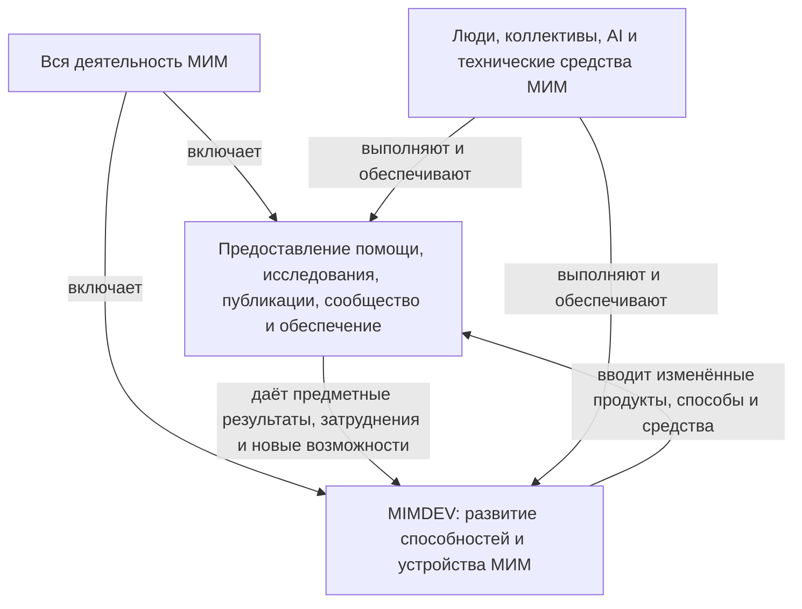

# MIMDEV52 - Архитектура развития МИМ

**MIMDEV — проект развития Мастерской инженеров-менеджеров, часть всей деятельности МИМ**. В пределах программы развития это верхний проект. Его результат — новые способности МИМ создавать, предоставлять и развивать помощь людям и организациям, исследовать недостающее знание и поддерживать культуру бесконечного развития. Развитие клиентов входит в этот проект как направление деятельности МИМ. Развитие самой Мастерской шире продаж, учебных программ и клиентского сопровождения.

Текущая архитектура определяет вложенность работ и границы результатов в программе развития МИМ. Её пересматривают в ходе стратегирования: достигнутые способности, обнаруженные ограничения и новые возможности меняют связи работ и способы их обеспечения. Изменения возвращаются в стратегию MIMDEV2 и программу MIMDEV6; обновлённая архитектура задаёт основание следующего шага. Стратегия, продуктовые решения и способы работы раскрываются в связанных документах. Учреждение подразделений, клиентские договоры и распределение бюджета требуют соответствующих решений МИМ и клиентов.

## MIMDEV52:1 - Место развития во всей деятельности МИМ

МИМ предоставляет помощь людям и организациям, исследует, создаёт и сопровождает методы и публикации, организует культурное участие, поддерживает собственные средства и экономику. **MIMDEV развивает способность Мастерской выполнять и продолжать эту деятельность.** В нём меняются продукты, способы работы, состав и подготовка исполнителей, средства, полномочия и организация взаимодействия. Текущее предоставление и обеспечение сохраняют свои результаты и обязательства перед получателями.



На схеме различаются назначения работ и их исполнители. Разработка новой теории может быть обычной работой исследовательского коллектива; новизна теории сама по себе ещё не означает, что МИМ приобрёл новый способ исследования. Аналогично развитие клиента может осуществляться освоенным способом помощи МИМ. Для развития самой Мастерской надо назвать приобретаемую ею возможность и то, что изменяется в её устройстве. Эти вопросы можно решать в одном проекте, сохраняя разные результаты.

Вложенность клиентских проектов в MIMDEV задаёт место принятого вклада МИМ в общей программе. Внутри конкретного проекта могут выполняться освоенное предоставление, разработка нового способа помощи и собственное развитие клиента. Поэтому проектное дерево ниже не служит организационной схемой или доказательством, что каждое действие развивает МИМ. Развитие не забирает себе всю текущую деятельность организации.

## MIMDEV52:2 - Как работы соотносятся с исполнителями

У МИМ нужны связанные представления о том, **что получает внешний участник**, **какие работы это обеспечивают**, **какими методами они выполняются** и **какие люди, коллективы и средства их выполняют и изменяют**. Проект объединяет работы по своему результату; метод задаёт способ действия; подразделение или иной коллектив может участвовать во многих проектах. Состав папок и перечень методов не устанавливают этот коллектив, его полномочия и доступное время.

Архитектура исполнения строится поперёк проектных ветвей. Для каждого выбранного результата надо соединить принимающего его участника, содержательную работу, нужные вклады и уполномоченных исполнителей. Затем сопоставить совместную нагрузку на одних и тех же людей и средства. Специалист может одновременно вести предоставление и развивать его способ; общий ресурс учитывается один раз, а ожидаемые результаты каждого назначения остаются различимы. Обособленный офис, распределённое исполнение и внешняя помощь сравниваются по этой конструкции.

Следующая таблица задаёт нужные функции и связи в МИМ. Названия исполнителей — предлагаемые назначения работ. Действующий состав подразделений, конкретные люди, их полномочия и загрузка в доступных материалах ещё не установлены.

| Направление деятельности МИМ | Что надо осуществлять и поддерживать | Что меняет MIMDEV и с кем это соединяется |
| --- | --- | --- |
| Помощь людям, B2C | Предметная помощь, учебная работа и сопровождение участника; координация доступных форматов | Разработка предложений и методов подготовки, подготовка ведущих и средств. Совместная работа разработчиков, ведущих и организаторов предоставления |
| Помощь компаниям, B2B | Принятый вклад в изменение компании, работа с её уполномоченными исполнителями и сопровождение | Новые способы корпоративной помощи и подготовки команды МИМ; соединение ответственного за предложение, предметных специалистов и исполнителей клиента |
| Исследования и общая методология | Получение научных результатов, разработка и редакционное сопровождение выбранных общих методов | Новые исследовательские возможности, организация программ и развитие редакционной команды. Исследователи и редакторы сохраняют свои предметные решения; МИМ определяет собственное обеспечение |
| Собственные люди и сообщество сотрудников МИМ | Доступность профессиональной работы, условий участия, признания, развития и переходов между ролями | Носитель общей ответственности HR получает нужные вклады руководителей, наставников и организаторов; MIMDEV развивает недостающие способности и способы этой работы |
| AI и инфраструктура | Доступность средств, данных, контекста и необходимых вычислений в выполняемой работе | Разработка, получение и освоение новых средств, изменение взаимодействия людей и AI. Техническое сопровождение соединяется с владельцами использующей практики |
| Сообщество и культурный вклад | Совместная работа и передача методов, поддерживаемые организаторами и добровольными участниками | Развитие способов участия и подготовки следующих организаторов; согласование вклада МИМ с самостоятельными решениями сообщества |
| Администрирование и экономика | Договорённости, оплата, доступы, ресурсное и организационное обеспечение | Разработка «Законтрактовать, поддержать» и других местных способов; связь организаторов предоставления, ответственных за ресурс и предметных руководителей |
| Стратегия и координация всей Мастерской | Выбор обязательств и использования общего ресурса, разрешение конфликтов между направлениями | Конструкция портфеля и способов его пересмотра; решения владельцев МИМ с участием руководителей соответствующих работ |

Общую ответственность HR за сообщество сотрудников и культуру следует отличать от исполнения всех культурных работ. В МИМ она может быть назначена одному из имеющихся участников с необходимыми полномочиями; отдельный отдел этим не учреждается. Предметные руководители обеспечивают работу, время и использование новых способностей, наставники помогают освоению, организаторы — передаче и продолжению практики. Внешнее сообщество МИМ сохраняет добровольное участие и собственные цели. Для клиента распределение этих вкладов выясняется в его организации, а не переносится из устройства Мастерской.

Для резидентур это означает, например, что координатор может участвовать в разработке способа ведения, а затем формировать программы, организовывать набор и координировать потоки. Первое имеет результат развития способа и способности МИМ, второе — результат предоставления. Совмещение требует согласованного времени; этот пример не задаёт устройство исследований, редакции или корпоративной помощи.

### MIMDEV52:2.1 - Как результат развития входит в текущую работу

В каждом направлении соединение строится по принимающему результату. Сначала определяется, что должно стать доступно получателю и какой способ МИМ это обеспечит. Затем выбираются разработка или получение недостающего вклада, его исполнители и ресурс наряду с действующими обязательствами. Принятый вариант должен включать того, кто будет пользоваться и сопровождать результат: способ может оказаться пригоден содержательно, но недоступен при фактической нагрузке или правах.

Переход к использованию требует подготовить людей и средства, согласовать полномочия и ограничения, обеспечить выполнение выбранной работы и решить, как сопровождать новый способ. Созданный текст, подготовленный исполнитель, предоставленная помощь и изменение у её получателя — отдельные результаты. Передача документа не завершает этот переход. Отдельное организационное назначение нужно тогда, когда существующий состав не может принять работу в нужных условиях; название нового офиса само по себе этого не решает.

Из использования возвращается конкретное затруднение или новая возможность. Оно может потребовать изменить обещание, предметный метод, продукт, поддержку, состав исполнителей или ресурсное решение. Соответствующий вопрос возвращается в свою ветвь MIMDEV; действующие обязательства и пригодные части способа продолжаются. Самостоятельные исследования также входят в портфель по своему научному основанию и не обязаны ждать сбоя клиентского продукта.

## MIMDEV52:3 - Иерархия проектов и их результаты

```text
MIMDEV — развитие МИМ
├── Стратегия и устройство развития самой Мастерской
├── Исследования и организуемый МИМ вклад в общие методы и Library
├── Развитие собственных людей, AI и инфраструктуры МИМ
├── Развитие способности МИМ развивать клиентов
│   ├── Общие продукты, способы предоставления и экономика помощи
│   ├── B2C — развитие людей
│   │   ├── Разработка и развитие предложений для людей
│   │   └── Проекты развития конкретных людей
│   ├── B2B — развитие компаний
│   │   ├── Разработка и развитие корпоративных предложений
│   │   └── Проекты развития конкретных компаний
│   │       └── Связанные изменения продуктов, команд, людей и AI
│   └── Общая практика МИМ «Законтрактовать, поддержать»
└── Развитие сообщества и культурного вклада МИМ
```

Дерево показывает организацию нашей работы и её принимающих результатов. Оно не превращает всех клиентов или участников сообщества в подразделения МИМ. Проект конкретного клиента включается в программу МИМ в пределах принятого вклада, а собственные цели и решения клиента остаются у него. Исследования, инфраструктура и подготовка исполнителей могут обеспечивать несколько ветвей; такие связи не требуют копирования проекта под каждого получателя.

| Уровень | Что развивается | Какой результат следует получить |
| --- | --- | --- |
| MIMDEV в целом | МИМ как организация и её способность продолжать развитие | Связать стратегию, исследовательский портфель, продукты, организационное устройство и общий ресурс; осуществлять выбранные переходы |
| Клиентское направление МИМ | Способность МИМ помогать разным клиентам и развивать саму помощь | Портфель предложений, методы предоставления, подготовленные исполнители, AI-средства и жизнеспособная экономика |
| B2C | Предложения для развития человека | Способ помогать человеку получать новые мастерства и организовывать дальнейшее развитие; затем — отдельное осуществление для конкретного человека |
| B2B | Предложения для развития предприятия | Способ совместно создавать новые продуктовые и организационные возможности предприятия и продолжать развитие; затем — отдельный клиентский проект |
| Конкретный клиент | Определённый человек или организация | Предметная конструкция изменения, её осуществление и согласованный объём помощи, со своими условиями и свидетельствами результата |

Плательщик не определяет развиваемого агента. Компания может оплатить личную резидентуру сотрудника; это само по себе не создаёт проект развития компании. В B2B обучение людей может быть необходимой частью приобретения коллективной способности, но не заменяет изменение совместной работы. Команда людей и AI, отдельный человек, AI-система и предприятие требуют своих механизмов развития.

Личная траектория участника шире его нынешнего вклада в организацию. Совместный проект соединяет цели компании и человека в пределах выполнимых обязательств; независимое исследование или переход человека в другую область может оставаться вне них. Поэтому развитие сотрудника не целиком включается в корпоративный проект. Изменение интереса компании, включая автоматизацию прежней человеческой работы, возвращает стороны к выбору совместной части и помощи, сохраняя самостоятельность человека.

## MIMDEV52:4 - Развитие самого МИМ и внешняя помощь

Внутренняя работа МИМ включает выбор стратегии и исследований, создание новых продуктов и методов, развитие команды и средств, распределение ресурса и пересмотр способа, которым Мастерская организует своё развитие. Это собственная деятельность организации. Она может выполняться распределённо или обеспечиваться отдельным офисом; внутренний заказ на такую работу не следует описывать как продажу МИМ услуги самому себе.

МИМ может организовывать и обеспечивать исследования, разработку методов, редакционную работу FPF Library и подготовку её исполнителей. В портфель входят выбранный научный или методический результат, собственный вклад МИМ и его обеспечение: исполнители, время, средства и работа с зависимыми публикациями. Совместная работа учитывается в пределах принятого вклада МИМ. Место публикации и круг будущих пользователей результата определяются отдельно; хранение общего текста у владельца Library не исключает создающую его работу из развития МИМ. Основание этой связи уже раскрыто в MIMDEV6:6.4/:7/:9.

Ближайший собственный результат предлагаю сформулировать так: **получить и осуществить конструкцию развития МИМ, в которой исследовательские программы, продукты, способности исполнителей и обеспечение соединены по принимающим результатам и ограниченному ресурсу**. Из неё должно быть понятно, какую новую возможность получает Мастерская, за счёт каких работ и что откладывается при выборе. MIMDEV уже даёт значительную часть содержательного основания; ещё нужны устройство осуществления, реальные полномочия и ресурсные решения.

Например, МИМ может одновременно развивать математическое основание методов, подготовку следующих методологов и корпоративную помощь. Исследование даёт собственный научный результат и возможный вклад в способы синтеза. Подготовка исполнителей позволяет предоставлять помощь без постоянного участия первоначального автора. Корпоративное направление создаёт новую способность МИМ работать с организациями и потенциальный доход. Нужно сконструировать выполнимую совокупность этих работ, сравнить альтернативы их обеспечения и сохранить самостоятельные основания исследования. Один общий балл по ближайшей выручке не решает эту задачу.

Внешняя помощь находится внутри клиентского направления. Там МИМ выступает поставщиком, человек или компания — получателем выбранного вклада. **Разработка услуги, предоставление услуги и развитие клиента — разные работы.** Хорошо разработанный способ сопровождения ещё не означает, что конкретный клиент получил новую способность. Успех одного клиента, в свою очередь, не устанавливает возможность МИМ воспроизводить помощь другим при доступном ресурсе.

MIMDEV3:5, MIMDEV6 и MIMDEV51 описывают корпоративное предложение и способы его обеспечения. Организационная форма и конкретные обязательства определяются для принимаемой работы; наличие предложения само по себе не означает учреждения офиса или заключения договора.

## MIMDEV52:5 - B2C и B2B внутри клиентского направления

Для B2C уже есть программы МИМ, опыт резидентур и сообщество, Guides и развиваемые средства работы с AI. Следующая разработка должна усиливать помощь человеку в получении новых конструкций собственного проекта и в освоении способов дальнейшего развития. Новая резидентура — одно применение, самостоятельная помощь с AI — другое. Общие методы и материалы используются совместно, а подготовка, практика и объём поддержки определяются по человеку и обещанию продукта. Продуктовые варианты раскрыты в MIMDEV3.

Для B2B предметом служит развитие компании: её продуктов, способов деятельности и коллективных возможностей. Офис развития, распределённая работа руководителей и практиков, внешняя помощь и AI — сравниваемые формы обеспечения. Первым вариантом предложения рекомендую совместную разработку с командой клиента и передачу ей выбранных способов. При сильной внутренней команде достаточно адресной помощи; преимущественно внешнее исполнение требует иного состава обязательств. Это экспертный исходный выбор, который уточняется по предмету и обеспечению конкретного клиента. Конструкция первого этапа помощи раскрыта в MIMDEV51.

В обоих направлениях предложение различает полезный результат для получателя, личное мастерство, совместную способность и воспроизводство культуры. Пригодное решение может быть выполнено экспертом или AI; личное освоение требует собственного действия, а способность компании — доступной координированной работы. Культурный результат появляется в дальнейшем использовании, передаче и развитии способов. Обещанные результаты соединяются через необходимые вклады и получают свои основания приёмки. Management.Reference:4.4–4.7 документа Management объясняет эту связь; MIMDEV51 конкретизирует её для корпоративной помощи.

Получатель проходит собственный путь, включающий работу и контакты вне МИМ, паузы и возвращения. В B2B покупатель, руководитель, сотрудник-участник и пользователь продукта могут быть разными людьми с разными интересами. В B2C человек может одновременно учиться, работать, помогать коллегам и участвовать в сообществе. Устройство помощи должно учитывать эти связи; последовательность встреч поставщика описывает только его часть. Удобство участия и впечатление от помощи важны, но об освоении судят по приобретаемому действию и дальнейшему использованию.

Для производителя оборудования первый результат может состоять в новом семействе изделий и способе его изготовления и обслуживания. Для цифровой команды — в новой услуге и способе её создания людьми и AI. Такие проекты получают разные предметные модели, исследования, архитектуры и организационные решения. Проверки помогают синтезу и осуществлению этих результатов.

Клиентские проекты создаются с появлением идентифицируемого получателя, предмета и владельцев решений. До этого разработка предложения и исследование аудитории ведутся в B2C или B2B. Неизвестное имя клиента не мешает разрабатывать способы помощи, но не даёт основания придумывать действующий заказ или личный проект. Предложение первого корпоративного проекта и его осуществление имеют разные условия завершения.

## MIMDEV52:6 - Сообщество и общая практика предоставления

МИМ может поддерживать сообщество выпускников, инженеров-менеджеров и организаторов развития. У него собственные культурные результаты: совместное исследование и изобретение, передача методов, новые носители практики, продолжение работы вне МИМ. Участник может быть клиентом, партнёром или соавтором. Добровольное участие не означает обязанности выполнять работы МИМ. Поэтому сообщество сохраняет отдельную ветвь верхнего проекта и связи с B2C и B2B.

Совместная помощь использует время организаторов, наставников и участников. Подготовка разбора, ответы новичкам, поддержка и распространение материалов входят в полную нагрузку того, кто их выполняет. Перенос этих работ из МИМ в сообщество требует согласованных условий и доступного времени. Добровольный вклад имеет предел; обещание МИМ клиенту обеспечивается только тем вкладом, который действительно получаем.

Практика **«Законтрактовать, поддержать» принадлежит МИМ как поставщику помощи клиентам** и располагается внутри клиентского направления. Общая часть объясняет, как получить содержательный запрос, сконструировать предложение, согласовать выполнимые обязательства, обеспечить предоставление, изменить объём и завершить или продолжить помощь. Специализации B2C и B2B учитывают разные результаты, полномочия, сопровождение и стоимость. Местные способы оформления, оплаты, предоставления доступа, хранения контекста и распределения исполнителей входят в LPF этой практики. Конкретный договор и текущая загрузка хранятся как свои рабочие документы.

Постановка этой практики может быть конечным проектом внутри клиентского направления. После её введения обслуживание продолжается как деятельность, а изменение способов обслуживания — как развитие. Она помогает осуществлять проекты клиентов, но не владеет их стратегией и не подменяет содержательный синтез.

## MIMDEV52:7 - Проходы по системной мантре

Основание — FPF A.1.STM:0/:3/:4. Мантра связывает нужное изменение вне системы с выбранной системой и её границей, внутренним устройством, работами её создания или изменения и развитием самих создателей. Обратное чтение находит первый неподдержанный ответ; прямое прослеживание опирается на действительные работы, изменения и использование. FPF A.1.SCR:4.2/:4.7 помогает сохранить различие самой системы, её способности, метода, работы и описания.

Здесь мантра применяется к замыслу архитектуры. Основания — различённые результаты MIMDEV1:2/:5, стратегия MIMDEV2, продуктовые конструкции MIMDEV3 и программа MIMDEV6. Они дают цели и гипотезы способов, но не устанавливают состав действующих коллективов или состоявшееся приобретение способности. Поэтому карта ниже различает целевые системные позиции и условия их осуществления. В ней нет утверждения о принятой сети преобразований или о том, что будущий исполнитель уже работает.

### MIMDEV52:7.1 - Изменение вне системы и выбор её границы

| Проектное рассмотрение | Нужное изменение вне рассматриваемой системы | Система, её граница и гипотеза полезного функционирования |
| --- | --- | --- |
| Развитие МИМ в целом | Люди и организации получают доступ к более сильным способам развития; исследователи и практики получают пригодные знания; культура получает новых самостоятельных носителей | Мастерская как организация. Предлагаемая организационная граница охватывает собственных исполнителей и средства, связанные совместной работой и полномочиями; её фактический состав надо восстановить. Клиент и сообщество сохраняют самостоятельность. Связь исследования, разработки, предоставления и обеспечения должна позволять получать и продолжать эти внешние результаты |
| Развитие человека, B2C | В собственных проектах и жизни человека становятся доступны новые действия и результаты | Конкретный человек — носитель приобретаемого мастерства. Учебная программа, ведущий и AI могут обеспечивать его развитие. Гипотеза помощи включает собственное действие человека; доступ к чужому выполнению сохраняет иной вид результата |
| Развитие компании, B2B | Её получатели получают новые или лучшие продукты и возможности; меняется положение компании в её окружении | Конкретная компания либо обоснованно выбранная часть. Её продукты, совместная работа, полномочия и обеспечение должны поддержать нужный результат. Поддержка развития может быть распределённой или офисной; выбор требует границы самого изменения |
| Создание или изменение системы в проекте клиента | Пользователь будущего продукта или иного результата получает нужное изменение в своей работе или среде | Система, которую создаёт или меняет клиент: её выбирают по конкретному внешнему использованию. Клиентская команда выступает создателем, МИМ может помогать ей. Развитие команды и результат создаваемой системы остаются разными предметами |
| Развитие средств и организации помощи МИМ | Получатель может воспользоваться выбранной помощью при согласованных условиях и продолжить свою работу | Для технического проекта — определённое развёрнутое средство; для организационного — коллектив предоставления с его средствами и взаимодействием. Слово «услуга» не выбирает систему: описание продукта, обещание, выполнение помощи и её обеспечивающее устройство надо различить |
| Развитие издательского и технического обеспечения Library | Автор может передать пригодное содержание, читатель — найти и использовать его; зависимые публикации могут обновляться | Если меняется доступ, предметом может быть конкретная программная система хранения, поиска и выдачи. Если меняется редакционное исполнение — организованный коллектив и его средства. Канон, отдельный метод и научная теория имеют собственный предмет; их качество не следует из исправности программной системы |

Эти позиции не закреплены навсегда за названием направления. В одном B2B-проекте может понадобиться рассмотрение продукта компании, самой компании и обеспечивающей команды МИМ. Переход между ними меняет внешний результат и границу системы. Он не позволяет переносить вывод о готовности одного результата на другой.

### MIMDEV52:7.2 - Связанные уровни и развитие внешней среды

Во внутреннем развитии МИМ и в помощи клиентам применяется общее различение MIMDEV1:2.3: сотрудник → сотрудник с AI → команда людей и AI → коллектив команд с корпоративными AI → внешняя бизнес-экосистема. Стрелки здесь задают смену масштаба рассмотрения, а не начальственное подчинение или утверждённую физическую вложенность. Общие средства могут пересекать команды. Сообщество носителей культуры имеет собственные отношения передачи и продолжения практики и не объявляется одним управляемым агентом.

Для каждого выбранного перехода нужны обе стороны зависимости: что у его участников станет возможным и какое полезное изменение это позволит в более широком использовании; какие изменения других участников и средств сделают сам переход достижимым. Сумма освоений сотрудников не заменяет совместной способности команды. Новая корпоративная платформа не устанавливает личного мастерства. Внешнее соглашение может открыть внутреннюю возможность без нового обучения. Если новая возможность одного уровня ухудшает другой, меняется конструкция совместной работы либо явно выбирается приемлемый компромисс с соответствующими владельцами решений.

Внешняя среда не только предъявляет ограничения. Компания способна вместе с независимыми участниками создавать отраслевые ассоциации, общие средства, стандарты и формы coopetition. Предмет — изменение доступных возможностей этой сети участников и положения компании в ней. У такого проекта свои партнёры, вклады и правила совместного решения; внутренний мандат офиса не даёт ему власти над окружением. В портфель включается посильный вклад компании, а не обещание управлять целой экосистемой. В B2B МИМ помогает клиенту построить такую конструкцию; в собственном развитии МИМ определяет свой внешний вклад и его обеспечение.

При проектировании офиса для культуры развития целевой переход начинается у сотрудников и коллективов: новая проблематизация, стратегирование метода, его освоение и улучшение, затем инициативный следующий шаг после достаточного успеха. Работа с сообществом обеспечивает участие, передачу, признание и изменение практики; организационная работа — процессы, роли, назначения, ресурс и использование результата. Из зависимостей между этими работами выводятся устройство офиса и помощь МИМ. Пригодная схема организации сама по себе не заполняет пропущенное объяснение целевого перехода. Для вывода о достаточности помощи нужны хотя бы минимальные реальные сдвиги поведения сотрудников/сообщества, команд и компании в объявленном охвате. Получение схемы, занятость офиса и отдельный успех имеют свои результаты; они не заменяют изменения обычной практики. Поэтому календарь помощи включает повторяемую работу, освоение и взаимодействие, а оценка её выхода сопоставляет исходное и полученное поведение. Подробная продуктовая конструкция и основания этого суждения находятся в MIMDEV3:5.4; срок конкретного клиентского этапа определяется в его предложении.

### MIMDEV52:7.3 - Создатели, развитие создателей и первый недостающий ответ

| Рассмотрение | Работы создания или изменения и развитие их исполнителей | Что даёт нынешняя архитектура; какой ответ нужен дальше |
| --- | --- | --- |
| МИМ | Сконструировать портфель, изменить выбранные продукты и практики, подготовить людей, получить средства и ввести изменения. Далее развивать способность тех, кто проектирует и осуществляет такие переходы | Направления, различия результатов и связи с общими методами названы. Для осуществления первой конструкции недостаёт распределения выбранных работ между реальными исполнителями с общим ресурсом и полномочиями. Следующий результат — варианты такого распределения вместе с сохраняемыми текущими обязательствами |
| Человек | Совместная работа человека, ведущего и доступных специалистов или AI над приобретаемыми действиями; разработка помощи и подготовка следующего ведущего имеют свои результаты | Есть виды помощи и основание разрабатывать её до выбора участника. Личное осуществление остаётся открытым до выбора человека, нужных действий и доступной ему практики. Это не препятствует разработке общего предложения |
| Компания | Её уполномоченные руководители и специалисты с согласованной помощью МИМ изменяют продукты, совместную работу и обеспечение; отдельно развиваются организаторы последующих изменений | Офис и распределённая форма сохранены. Для цели культуры бесконечного развития на каждом рабочем месте MIMDEV51 раскрывает переходы и предполагаемую помощь. Конкретные предметные работы, принимающие решения участники и граница оплачиваемого вклада остаются предметом переговоров |
| Система в проекте клиента | Предметная команда проектирует, создаёт, вводит и сопровождает систему; МИМ помогает получить недостающие методы или способности. Подготовка команды и её создателей планируется по обнаруженной нехватке | Тексты не выбирают за разные проекты один продукт и одну предметную модель. Первый недостающий ответ — конкретное внешнее использование, от которого зависит выбор системы и её границы. Подробная конструкция оборудования не отвечает за цифровую услугу или исследовательский инструмент |
| Средства и организация помощи | Разработчики, предметные специалисты и будущие исполнители соединяют содержание, программные средства и способ предоставления; освоение и сопровождение входят в получение работоспособного результата | Предложения различены, но фактическая организация исполнения не описана. Нужна архитектура выбранного предоставления: взаимодействующие участники, средства, принимаемые результаты и доступная нагрузка. Из неё следует, каких исполнителей и какие способы их подготовки надо развивать |
| Обеспечение Library | Редакторы, авторы и технические исполнители меняют выбранный элемент; развитие их методов и подготовки обеспечивает следующие изменения | MIMDEV6:6.4/:7/:9 связывает научные, редакционные и ресурсные решения. Для конкретного изменения надо выбрать, что должно стать доступно автору или читателю, и какая работа МИМ это обеспечивает. Общий метод остаётся у своего владельца; действительная связь с использованием требует результата в принимающей работе |

Для исследований мантра не заменяет постановку научного вопроса. Теория, доказательство, язык и метод могут быть искомым содержанием исследования; из их названия не следует отдельная действующая система. Системное рассмотрение полезно, когда вопрос касается исследовательского коллектива, установки, вычислительного средства или их развития. В остальных случаях следует продолжать предметную научную конструкцию MIMDEV7/MIMDEV8/MIMDEV9. Это сохраняет исследования в программе МИМ без вымышленной системы и без обязательного ближайшего коммерческого эффекта.

В культурной работе также сначала выбирается собственный вклад МИМ и самостоятельное действие участников. Сообщество не следует считать одним управляемым МИМ исполнителем. Системный проход можно делать для конкретной организации или реализованного средства совместной работы, когда её состав и граница нужны для решения. Более широкая передача и эволюция практики сохраняют свой предмет и соответствующие методы.

### MIMDEV52:7.4 - Что мантра меняет в следующем архитектурном решении

Для общего портфеля при принятой стратегической гипотезе ближайший разрыв находится между конструкцией желаемого развития и **организацией его осуществления и использования во всей Мастерской**. Это вывод для данного портфельного решения: в новом продукте или клиентском предложении первая отсутствующая связь определяется заново от его получателя по A.1.STM. В частности, неполное объяснение культурного перехода нельзя считать уже полученным только потому, что в общем портфеле очередь дошла до организации исполнителей. Исправление требует описания выбранных работ, взаимодействия реальных исполнителей и общего ресурса. Один «офис развития» не закрывает эту связь для исследований, редакции, B2C, B2B, инфраструктуры и сообщества. Если связь внешнего использования с устройством ещё не объяснена, примените FPF C.32.P2S:4 и верните полученные структурные варианты в архитектурный выбор. Для сравнения их совместного обеспечения используйте STR.16. Текущие варианты портфеля и организации приведены в MIMDEV6:14; их уточняют при принятии очередной работы и изменении условий. Выбранная конструкция требует осуществления и наблюдения результата в принимающей деятельности.

Предлагаю сравнить распределённое ведение развития руководителями работ и выделенную координацию портфеля, сохраняя предметное исполнение в соответствующих коллективах. Первая конструкция экономит отдельный координационный ресурс, но требует выполнимого согласования общих зависимостей и нагрузки. Во второй появляется исполнитель для этого согласования, но его работа и полномочия тоже требуют обеспечения. Отдельный офис имеет смысл как обоснованный вариант такого устройства, когда ему действительно поручаются связанные работы. На доступной базе рекомендую сначала конструировать распределение работ и выделить нужную координацию по фактическим зависимостям; вопрос учреждения подразделения решается по полученной конструкции.

Для прямого прослеживания сейчас подтверждено наличие подготовленных замысла, программ и архитектурных описаний. Следующее требуемое звено — согласованное решение о выбранных работах, исполнителях и обеспечении на их основании. Сам текст не устанавливает назначение людей, проведение нового предоставления, приобретение способности МИМ или изменение у клиента. После соответствующих решений прослеживаются введение способа, его действительное использование и результат получателя. Отсутствующая связь оставляет открытым именно этот вывод, сохраняя пригодные местные результаты. C.11.DUA позволяет уже сейчас рекомендовать и разрабатывать варианты, уточняя факты, которые способны изменить выбор.

## MIMDEV52:8 - Где применяется метод и где метод ещё создаётся

В каждой содержательной разработке следует прямо объяснять основание используемого способа. Не достаточно общей фразы «работаем по FPF». Нужно назвать пригодный метод, тот вклад, который он действительно даёт, и недостающую конструкцию. Это различие принадлежит объяснению текущей работы, а не отдельному журналу соблюдения правил.

| Ситуация | Что допустимо утверждать | Как продолжать работу |
| --- | --- | --- |
| Метод Library прямо отвечает на вопрос | Используется определённый метод в его условиях | Сослаться на источник и показать его применение к своему предмету |
| Требуется местная конкретизация или соединение готовых методов | Разрабатывается способ данной практики на известном основании | Объяснить соединение, местные роли, средства и ограничения; оформить повторяемую часть в LPF при необходимости |
| Нужного способа нет в найденном материале либо его достаточность не установлена | Выполняется экспертный синтез или исследование кандидата метода | Построить доступное решение, раскрыть основания и неопределённость; передать общий методологический вопрос владельцу Library |
| Кандидат оказался полезен за пределами одного проекта | Есть основание рассмотреть обобщение | Сопоставить с актуальными методами и SoTA, определить область и архитектуру DPF; единичное применение ещё не делает метод библиотечным |

Конструкция развития и продолжения опирается на C.40.OD, C.40.JD и C.40.NP. Для построения и пересмотра осуществимого портфеля используйте STR.16: сохраните самостоятельные результаты, установите действительные зависимости и сравните способы обеспечения на общем ресурсе Мастерской. Если недостаёт самого способа получить результат, примените C.39 и верните объяснённый способ в выбранную работу. C.11.DUA позволяет выбрать соразмерное уточнение неизвестного либо обоснованное продолжение с имеющимися сведениями. При разработке учебной помощи будущей аудитории HCD.28 помогает получить целую конструкцию продукта, которую затем нужно учесть в архитектуре и обеспечении. Вложенность проектов и предмет B2B-помощи остаются архитектурными решениями МИМ.

Клиентское сопровождение также нельзя объявить готовым общим методом на том основании, что его этапам подобраны PatternID. В нём должны быть объяснены сами способы получить продуктовую конструкцию, научный вопрос, организационное решение и согласованное продолжение. Проверки выбираются по этим результатам.

## MIMDEV52:9 - Общая методология и уровни FPF DPF LPF

Связь MIMDEV с общей методологией имеет два независимых основания. Первое — организация работы: МИМ выбирает и обеспечивает собственные исследования, разработку методов, редакционные вклады и подготовку исполнителей, а также получает результаты других участников. Эти выбранные работы входят в его портфель, даже когда результат публикуется в FPF Library, Guides или самостоятельном научном издании. Для них требуется собственное решение о результате, ответственном и ресурсе; настоящая архитектура не устанавливает конкретный бюджет.

Второе основание — применимость и сопровождение результата. Научная содержательность, область метода и место в FPF или DPF обосновываются по предмету. Редакторы принимают решение о каноне, МИМ — о своём вкладе и его обеспечении. Общие тексты сохраняют владельцев и репозитории. Финансирование МИМ не ограничивает результат только задачами МИМ и не устанавливает его универсальность. Работа общей кампании, которую организуют другие участники, также не становится обязательством МИМ автоматически.

Так, при выборе математической разработки из MIMDEV6:6.3 МИМ может обеспечить время исследователя и предметное обсуждение. Теорема, контрпример или новый язык сохраняют самостоятельный научный результат. Если из него удаётся получить полезный общий метод, подготовка библиотечного объяснения получает свой редакционный вклад и решение о включении в канон. Успех исследования ещё не означает готовность этого метода; отсутствие ближайшего продукта не лишает исследование собственного основания.

МИМ использует методы Library и выбирает собственные вклады в их создание: исследования, разработку объяснений, редакционную работу и подготовку исполнителей. Потребность в методе передаётся его действительному владельцу вместе с принимающей задачей; получение результата не делает всю работу владельца частью обязательств МИМ.

Опора архитектурного согласования — опубликованные FPF Core, Library.Reference и каталог DPFs. Общие методы развития признаны трансдисциплинарными и входят в Core. OCE имеет предметное место в Management, HCD — в Human Capability Engineering, математические специализации MMP — в Foundational Thinking; инженерные средства используют Engineering. Research Method Practice и ряд других DPF самостоятельны. Реальные операции берутся из паттернов, архитектурные причины и связи — из Library.Reference и архитектурных объяснений соответствующих DPF Suites.

Запрос МИМ охватывает конструирование стратегии и связанных исследовательских программ; осмысленные шкалы их сравнения; связь вложенных циклов улучшения, развития на марже и новых возможностей; выбор организационных форм; развитие людей, коллективов и AI; разворачивание методов в местной практике; экономику продолжающейся поддержки. Нужны объяснённые методы и связи, позволяющие получить целый результат. Наличие отдельных подходящих паттернов ещё не устанавливает достаточность их состава.

Иерархия фреймворков и иерархия проектов отвечают на разные вопросы. Core содержит трансдисциплинарные методы и понятия, включая метаонтологический Kernel; DPF описывает предметные методы, применимые в разных организациях; LPF — определённую местную практику. Suite описывает составную дисциплину через составляющие и конструктивные связи знания и практики по E.4.DPF и E.4.PFAD. Один клиентский проект может использовать многие DPF; использование внешнего метода не устанавливает дисциплинарного включения. Ни крупный проект, ни количество папок или совместная сборка публикаций не предрешают появление Suite.

Местная практика подготовки документов отличается от практики развития Мастерской. Собственное развитие МИМ и предоставление помощи клиенту имеют разные принимающие действия, хотя могут пользоваться одинаковыми общими источниками. Общую процедуру не следует копировать в несколько конкурирующих текстов.

Для разворачивания DPF сначала выбирается полезное применение, получается предметное решение и обеспечиваются его осуществление и освоение. C.40.OD:4.7–4.8 связывает конструкцию с принимающей работой и её условиями; E.4.DPF задаёт создание LPF, если нужна повторяемая местная практика. В LPF сохраняются местные роли, средства, условия адаптации и обновления поставщиков. Полные методы не копируются. При реальном пробеле в способе разворачивания формулируется отдельный запрос; само наличие местной работы не требует нового универсального DPF.

## MIMDEV52:10 - Решения MIMDEV и запросы к разработчикам методов

Вложенность MIMDEV принята как исходное условие. Для следующих решений Library даёт ниже названные методы. Требуется применить их к МИМ и получить связный результат; имена паттернов служат входом в объяснение. Если способ не даёт нужной операции в её условиях, поставщику возвращается точное затруднение. Для STR.16, как и для других поставляющих методов, статус и текущая редакция определяются публикацией владельца Library. Применение метода к этой конструкции само по себе не устанавливает эффективность ещё не выполненной работы.

| Решение MIMDEV | Трудный выбор | Какой метод нужен и куда войдёт его результат |
| --- | --- | --- |
| Сконструировать осуществимый портфель собственного развития | Какие исследования, библиотечные и редакционные работы, продукты, подготовку исполнителей и инфраструктуру обеспечивает МИМ; как соединить их с текущими обязательствами | STR.16:4.1–4.7 сохраняет самостоятельные результаты, различает зависимости и общий ресурс, сравнивает совместное и раздельное обеспечение. Варианты и принимаемые компромиссы входят в стратегию и MIMDEV6; действительные ресурсные решения остаются у совладельцев |
| Связать стратегию, исследования и вложенные циклы развития | Улучшать освоенное, развивать возможность на марже или открывать новый класс задач; сохранять самостоятельную научную перспективу | C.40.NP строит следующую достижимую проблему; RMP формулирует познавательный результат; STR.16:4.5 сопоставляет разные вклады и C.11.DUA ограничивает дополнительное изучение. Результат — выбранные исследовательские вопросы и их обеспечение без обещания заранее известного открытия |
| Выбрать организационное обеспечение развития | Офис, распределённая практика, внешняя помощь, совместная разработка или внешнее исполнение; распределение работы людей и AI | C.32.MWA.PP сравнивает исполнение и обеспечение; OCE.8 — целые варианты для заданного организационного результата; STR.16 — совместную возможность нескольких работ. Результат — конструкция исполнителей, полномочий и нагрузки всей МИМ; клиентское применение получает свои условия |
| Сконструировать помощь, ведущую к развитию выбранного получателя | Личное освоение, изменение команды или компании; собственный вклад МИМ и действия клиента | C.40.JD соединяет способ, носителя и обеспечение, HCD и OCE дают предметные методы. Результат — объяснённое предложение B2C/B2B с приобретением способности, внешней помощью и условиями продолжения, затем его клиентская конкретизация |
| Развернуть и обновлять методы в местной практике | Что брать из Library, что описывать в LPF МИМ и клиента; как принимать обновления поставщика | C.40.OD:4.7–4.8 связывает способ с действительной работой; E.4.DPF — с устройством LPF. Результат — местная практика с доступом к общим источникам и условиями пересмотра, включая «Законтрактовать, поддержать» для клиентского направления |

Принимающее решение — очередной выбор портфеля собственного развития. По STR.16 уточняйте целые варианты с общим и раздельным обеспечением, сохраняя разные основания исследований, продуктов и культурной работы; текущий сравнительный результат находится в MIMDEV6:14. Сравнение потребляет сведения о действующей загрузке, доступных способностях, полномочиях и ресурсах МИМ; неизвестные величины сохраняются как условия предложения. Экспертная конструкция возможна до их окончательного подтверждения по C.11.DUA. Ресурсное обязательство требует действительного решения. Если при применении выявится отсутствующая операция, её запрос возвращается владельцу метода; остальные работы продолжаются по собственным основаниям.

## MIMDEV52:11 - Документы и границы доступа

Содержание распределяется по владельцу принимающего результата. Концепция, стратегия, архитектура, исследовательская программа и описание метода сохраняют свои виды. Они не становятся LPF от включения в один проект.

| Состав | Ответственность за содержание | Граница повторного использования |
| --- | --- | --- |
| Верхний проект развития МИМ | Общая архитектура, стратегия, портфель, исследования и собственное развитие Мастерской | Вложенные проекты используют общие основания; стратегия МИМ не копируется в каждый из них |
| Клиентское направление и общие предложения B2C/B2B | Способность МИМ предоставлять помощь, общие продукты и методы её организации | Повторяемые конструкции поддерживаются один раз, применение получает собственное обоснование |
| Конкретная компания B2B | Уполномоченные участники компании принимают её цели, изменения, ресурс и доступы | В общую практику входят только разрешённые обобщения; данные компании остаются в согласованной области доступа |
| Конкретный человек B2C | Участник и согласованные помощники работают над его результатом | Личная работа и данные отделяются от общих материалов; участие не означает согласия на распространение личного случая |
| Исследования и вклад МИМ в Library | МИМ обеспечивает выбранную работу; исследователи и редакторы принимают свои предметные решения | MIMDEV6:6.4/:7/:9 связывает вклад, исполнителей и ресурс с научным и редакционным результатом |
| Общие методические и научные результаты | Владельцы FPF Library, руководств и соответствующих исследований | Канон и исходники сопровождаются у владельца; местные документы ссылаются на используемый вклад |

Граница доступа следует содержанию и полномочиям. Общие документы МИМ доступны для обсуждения и применения; сведения конкретного человека или компании не становятся общими из-за сходства задач. Содержательная вложенность проекта сохраняется, даже если материалы ведутся в разных пространствах. Разделение хранения оправдано различиями прав, сопровождающих и порядка использования, а не желанием создать отдельную папку для каждого вида работы.

## MIMDEV52:12 - Как связывать локальную практику с библиотекой

Для первого местного метода достаточно раскрыть узнаваемую ситуацию и полезный результат; предмет и полномочия; действия и их основания; используемые методы Library и ещё разрабатываемый вклад; местных исполнителей, данные и средства; способ освоения и обеспечения; условия следующего развития и пересмотра. Это стартовый шаблон содержания, не установленный новый LPF.

Например, местный метод МИМ связывает исследовательскую программу с продуктовой возможностью и выделением ресурса. STR.16 даёт способ такого выбора: сохранить самостоятельную научную ценность, установить реальную продуктовую зависимость и сопоставить способы их обеспечения. Какие люди принимают решение, где ведутся материалы и как доступен ресурс — местная конкретизация. Решение о ресурсе одной программы — отдельный результат применения. Аналогично в клиентском направлении общий способ построить услугу и конкретные правила предоставления МИМ различаются.

У зависимости указываются поставщик, используемый метод или результат, принятая редакция, местное применение и обстоятельство пересмотра. Изменение поставщика возвращает владельца практики к затронутому действию, а не требует синхронно переписать все LPF. Новую редакцию принимают, адаптируют местное соединение либо сохраняют прежнее основание с объяснённым ограничением. Актуальный адрес нужен для поиска, сведения о редакции — для понимания основания решения. Общие тексты и рисунки Guides остаются у Guides.

## MIMDEV52:13 - Синтез обучение и действие при неопределённости

Первый содержательный результат каждой разработки должен быть результатом синтеза: новым продуктовым решением, исследовательской постановкой, методом, организационным устройством или способом собственного развития. Проверки подчинены получению и освоению этого результата. Количество успешно проверенных примеров не отвечает на вопрос, правильно ли выбран сам предмет разработки.

Участники разных областей строят свои решения. Разработанный пример может помогать объяснению, однако один сквозной сюжет не устанавливает переносимость. Нужны предметные основания применимой связи, содержательно различающиеся случаи и собственная конструкция получателя. Исторические эксперименты Gentner, Loewenstein и Thompson (2003) поддерживают рассмотрение сравнения случаев при обучении переговорам; они не доказывают универсальную программу междоменного переноса. [Первичное исследование](https://groups.psych.northwestern.edu/gentner/papers/GentnerLoewensteinThompson03.pdf).

По C.11.DUA доступного материала достаточно, чтобы рекомендовать эту архитектуру и разрабатывать следующие конструкции. Неизвестность эффекта будущего офиса или услуги не требует сначала провести причинное исследование. Нужно объяснить экспертный выбор и уточнять то, что может изменить ближайшее решение: предмет клиентской работы, полномочия, доступные вклады и полную нагрузку. Проверка созданной конструкции, решение о ресурсном обязательстве и вывод о приобретённой способности имеют разные основания.

При сравнении стратегий и исследовательских программ важно сохранять смысл отдельных оценок: стратегический вклад, научную содержательность, достижимость следующего результата, стоимость и будущие возможности. Единый численный рейтинг без обоснованных шкал и правила компромисса скрывает выбор. STR.16:4.5 даёт способ такого сравнения, сохраняя различие результатов и принимаемые компромиссы; C.11.DUA позволяет использовать аргументированную экспертизу и уточнять допущения, способные изменить выбор.

## MIMDEV52:14 - Порядок развития архитектуры

Варианты портфеля и организации развития всей МИМ даны в MIMDEV6:14. Для органического роста сопоставляются развитие освоенных предложений, самостоятельное развитие человека с IWE и связанное развитие МИМ с компаниями. При обеспеченном корпоративном этапе последний вариант позволяет получить клиентский результат и новую способность МИМ. Действующее предоставление и самостоятельные исследования с AI-агентами сохраняют свои результаты; конкретный выбор зависит от доступного обеспечения и спроса.

Рекомендуемое устройство — небольшая общая координация при исполнении в направлениях, с распределённым специальным обеспечением. Это функции, полномочия и совместная работа людей и агентов внутри всей МИМ; новый штат офиса из этой рекомендации не следует. Исследовательская и редакционная работа уже выполняется, включая разработку Library агентами: её продолжение и новое расширение различаются с гипотетическим запуском после найма.

Сходство MIMDEV с пакетом развития клиента позволяет повторно использовать вопросы, связи документов и подходящие методические конструкции. Собственные стратегии, ресурсы и полномочия МИМ и компании сохраняются раздельно. Общая практика предоставления принадлежит клиентскому направлению MIMDEV, документы конкретной компании — её проекту со своим доступом и идентификаторами, канон методов — владельцам Library и Guides. Подробная граница и способ постепенного выделения общего основания даны в MIMDEV6:14.7.

Внутри развития МИМ сохраняются различия собственного результата Мастерской, результата клиента и общих методов. Такая вложенность позволяет принимать общий стратегический выбор, не подчиняя все исследования одной продаже и не превращая самостоятельного клиента в подразделение МИМ. Изменение портфеля, обязательств, состава исполнителей или границ доступа может изменить внутреннее деление. Решения о составе общих DPF остаются у владельцев Library.
