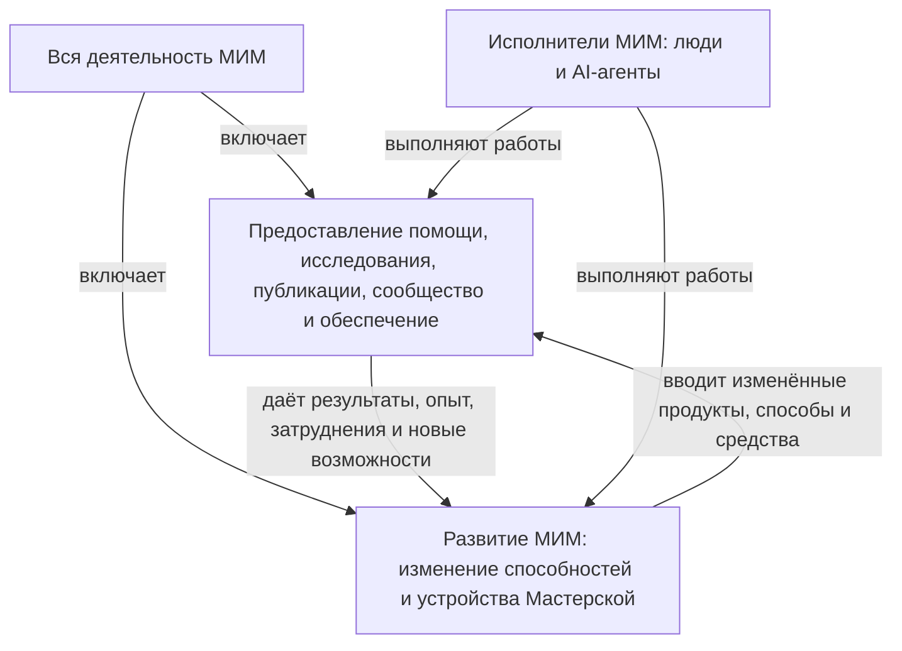

# MIMDEV52 - Архитектура развития МИМ

**«Развитие МИМ» — полный проект развития Мастерской инженеров-менеджеров, часть всей деятельности МИМ**. В нём Мастерская развивает свои методы, продукты, способы помощи людям и организациям, исследовательскую работу и подготовку исполнителей. Это должно расширять возможности МИМ решать научные и практические задачи и поддерживать культуру бесконечного развития. Работа по развитию клиентов входит в этот проект как одно из направлений. MIMDEV обозначает стратегический комплект документов, а MIMDO — подпроект методов и программ помощи развитию компаний.

Архитектура показывает, как работы по развитию МИМ связаны между собой и с его текущей деятельностью. Руководители и исполнители пересматривают её в ходе стратегирования: учитывают приобретённые способности, ограничения и новые возможности, меняют состав работ и их обеспечение. Изменения отражают в стратегии MIMDEV2 и программе MIMDEV6. Решения о подразделениях, клиентских договорах и бюджете принимают уполномоченные лица МИМ и клиентов.


## MIMDEV52:1 - Место развития во всей деятельности МИМ

МИМ помогает людям и организациям, ведёт исследования, разрабатывает и сопровождает методы и публикации, организует общение и совместную работу в сообществе инженеров-менеджеров. Для этого Мастерская обеспечивает финансирование и рабочую среду. **Проект «Развитие МИМ» расширяет способность Мастерской выполнять и продолжать эту деятельность.** В нём меняются продукты, способы работы, состав и подготовка исполнителей, средства, полномочия и организация взаимодействия.



На схеме различаются назначения работ и их исполнители. Разработка новой теории может быть обычной работой исследовательского коллектива; новизна теории сама по себе ещё не означает, что МИМ приобрёл новый способ исследования. Аналогично развитие клиента может осуществляться освоенным способом помощи МИМ. Для развития самой Мастерской надо назвать приобретаемую ею возможность и то, что изменяется в её устройстве. Один проект может принести новый научный вывод, дать клиенту новую возможность и улучшить способ, которым сама Мастерская помогает клиентам. Для каждого из этих результатов установите, что изменилось и кто это показал.

Клиентский проект включается в программу развития МИМ в объёме принятых обязательств Мастерской. В нём могут сочетаться оказание уже освоенной помощи, разработка нового способа помощи и развитие самого клиента. МИМ выполняет обязательства по текущей помощи и учитывает их при выборе новых работ развития. Дерево в MIMDEV52:3 показывает распределение работ по целям; постоянные подразделения и подчинённость исполнителей выбираются отдельно.


## MIMDEV52:2 - Как работы соотносятся с исполнителями

Для устройства МИМ нужно связать четыре вопроса: **кому и для чего нужен результат**, **какие работы его дают**, **какими методами их выполняют** и **кто способен их выполнить с доступными средствами**. Проект объединяет работы ради определённого результата; метод — способ действия; один коллектив может участвовать во многих проектах. При выборе исполнителей нужно установить их мастерство, полномочия и доступное время.

Распределение работ между исполнителями охватывает несколько проектных направлений. Для каждого выбранного результата определяют его получателя, необходимые работы и результаты их частей, затем — исполнителей с нужными полномочиями и средствами. После этого сопоставляют совокупную нагрузку на одних и тех же людей и средства. Специалист может одновременно оказывать помощь и разрабатывать способ её оказания. Для обеих работ нужны свои результаты и время. Доступное время людей и мощности средств задают для всего портфеля, а потребность в них рассчитывают по всем работам с учётом расписания. Обособленный офис, распределённое исполнение и внешняя помощь сравниваются по способности выполнить эти работы и по полным затратам.

Таблица показывает функции, которые нужно обеспечить в МИМ, и предлагаемые назначения работ. Для их принятия предстоит определить конкретных исполнителей, полномочия и загрузку с учётом существующих подразделений и договорённостей.

| Направление деятельности МИМ | Текущие работы | Работы развития и их исполнители |
| --- | --- | --- |
| Помощь людям, B2C | Помощь человеку в решении задач его проекта и освоении нужных методов; организация обучения и доступной помощи | Разработчики создают предложения и методы подготовки. Наставники осваивают новые способы обучения, организаторы обеспечивают их применение в программах |
| Помощь компаниям, B2B | Выполнение обязательств МИМ по помощи развитию компании совместно с её уполномоченными исполнителями | Ответственный за предложение, предметные специалисты и будущие исполнители разрабатывают корпоративную программу помощи и готовят команду МИМ к её проведению |
| Исследования и общая методология | Получение научных результатов, разработка и редакционное сопровождение выбранных общих методов | Исследователи развивают способы исследования, редакторы — способы разработки и сопровождения методов. Руководители МИМ обеспечивают выбранные программы ресурсами; предметные решения принимают исследователи и редакторы |
| Люди и сообщество сотрудников МИМ | Создание условий профессиональной работы, участия, признания, развития и переходов между ролями | Ответственный за HR организует совместную работу руководителей, наставников и организаторов сообщества. Они развивают способы подготовки людей, организации их работы и передачи практики |
| AI и инфраструктура | Предоставление средств, данных, рабочего контекста и вычислений | Инженеры разрабатывают и вводят новые средства, меняют взаимодействие людей и AI вместе с исполнителями и руководителями тех работ, где эти средства будут использоваться |
| Внешнее сообщество МИМ | Совместная работа и передача методов при добровольном участии | Организаторы и участники сообщества развивают способы совместной работы и готовят следующих организаторов. МИМ согласует свою помощь с самостоятельными решениями сообщества |
| Администрирование и экономика | Заключение договорённостей, получение оплаты, предоставление исполнителям МИМ и компании оговорённых прав на рабочие материалы, ресурсное и организационное обеспечение | Организаторы предоставления помощи, ответственные за ресурсы и предметные руководители разрабатывают местную практику «Законтрактовать, поддержать» и другие способы обеспечения работ |
| Стратегия и координация всей Мастерской | Выбор обязательств и использования общих ресурсов, разрешение конфликтов между направлениями | Владельцы МИМ вместе с руководителями работ выбирают портфель и развивают способы его пересмотра |

Общая ответственность HR за сообщество сотрудников и культуру означает организацию необходимой совместной работы. Её можно возложить на сотрудника МИМ с нужными полномочиями. Предметные руководители предоставляют сотрудникам работу, время и возможность применять новые способности; наставники помогают освоить методы; организаторы сообщества — передавать и продолжать практику. Внешнее сообщество МИМ сохраняет добровольное участие и собственные цели. В компании-клиенте функции распределяют с учётом её устройства и доступных исполнителей.

Например, координатор резидентур может вместе с наставниками разрабатывать способ их ведения, а затем формировать программы, организовывать набор и координировать потоки. В первой работе меняются способ и способность МИМ вести резидентуры; во второй резиденты получают предусмотренное обучение и помощь. Для совмещения этих работ нужно заранее согласовать время координатора.


### MIMDEV52:2.1 - Как результат развития входит в текущую работу

Руководитель выбранной работы вместе с её получателем определяет нужное изменение и способ МИМ его обеспечить. Затем выясняет, чего недостаёт: метода, средств, мастерства или времени исполнителей. Разработку, приобретение средств и подготовку людей сравнивают с использованием уже доступного. В выбранном варианте должны быть определены будущие пользователи и исполнители сопровождения, их полномочия и время наряду с действующими обязательствами.

Для начала применения руководитель организует подготовку людей и средств, согласует полномочия и ограничения, выделяет время на работу и сопровождение. Разработчик может подготовить описание метода, наставник — помочь исполнителю освоить его, исполнитель — оказать помощь получателю. Пригодность описания, освоение метода исполнителем, оказанная помощь и изменение у её получателя требуют своих оснований оценки. Если существующие исполнители не могут принять новую работу, нужно изменить распределение работ, обеспечить дополнительных исполнителей или привлечь внешнюю помощь.

Исполнитель, получатель или сопровождающий специалист может обнаружить затруднение либо новую возможность. Руководитель соответствующего направления МИМ разбирает, что нужно изменить: обещанный результат, метод, продукт, помощь, состав исполнителей или ресурсы. Пригодные способы и действующие обязательства учитываются в этом решении. Самостоятельные исследования включаются в портфель также по научному основанию — для ответа на исследовательский вопрос или разработки новой теории.


## MIMDEV52:3 - Направления и проекты развития МИМ

Дерево показывает состав работ в общей программе. Каждая ветвь объединяет работы по их назначению; названия MIMDEV и MIMDO указывают связанные комплекты документов и методический подпроект.

```text
Развитие МИМ — общий проект
├── Стратегирование, разработка и пересмотр документов MIMDEV
├── Организация исследований и разработки общих методов и FPF Library
├── Развитие мастерства сотрудников, AI и инфраструктуры МИМ
├── Развитие способности МИМ помогать клиентам
│   ├── Разработка общих продуктов, способов помощи и экономической модели
│   ├── B2C — помощь развитию людей
│   │   ├── Разработка и развитие предложений для людей
│   │   └── Помощь в проектах развития конкретных людей
│   ├── B2B — помощь развитию компаний
│   │   ├── Разработка методов и программ помощи компаниям — MIMDO
│   │   └── Помощь в проектах развития конкретных компаний
│   │       └── Согласованные работы по изменению продуктов, команд, людей и AI
│   └── Разработка и развитие практики МИМ «Законтрактовать, поддержать»
└── Развитие способов участия и совместной работы в сообществе МИМ
```

В клиентской ветви находятся работы, за которые отвечает МИМ. Цели клиента, собственные решения и остальные работы его проекта остаются в ведении клиента. Исследования, инфраструктура и подготовка исполнителей могут обеспечивать несколько направлений; их организуют совместно для этих получателей с учётом различий задач.

| Часть программы | Что развивается | Какой результат следует получить |
| --- | --- | --- |
| Проект «Развитие МИМ» в целом | МИМ как организация и её способность продолжать развитие | Выполнимая программа исследований, продуктов и организационных изменений с общими ресурсами; приобретённые благодаря её осуществлению способности МИМ |
| Клиентское направление МИМ | Способность МИМ помогать разным клиентам и развивать саму помощь | Портфель предложений, методы помощи, подготовленные исполнители, AI-средства и жизнеспособная экономика |
| B2C | Предложения для развития человека | Способы помогать человеку осваивать новые мастерства и организовывать дальнейшее развитие; программы помощи конкретным людям |
| B2B | Предложения для развития предприятия | Способы помогать компании приобретать продуктовые и организационные возможности и практиковать бесконечное развитие; программы помощи конкретным компаниям |
| Работа с конкретным клиентом | Способности определённого человека или организации | Осуществлённое изменение в проекте человека или работе компании и освоенный способ продолжать развитие; объём помощи МИМ, условия и основания оценки согласуются для этого проекта |

Плательщик не определяет, кто развивается. Компания может оплатить личную резидентуру сотрудника; это само по себе не создаёт проект развития компании. В B2B обучение людей может быть необходимой частью приобретения коллективной способности, но не заменяет изменение совместной работы. Для развития отдельного человека, AI-системы, команды людей с AI и предприятия нужны разные методы.

Личная траектория сотрудника шире его работы в нынешней организации. Совместный проект соединяет цели компании и человека через выполнимые обязательства. Независимое исследование или переход человека в другую область могут оставаться за пределами этих обязательств. При изменении интересов компании, в том числе при автоматизации прежней человеческой работы, стороны пересматривают совместную работу и нужную человеку помощь. Решения о дальнейшем личном развитии остаются за человеком.


## MIMDEV52:4 - Развитие самого МИМ и внешняя помощь

МИМ выбирает стратегию и исследования, создаёт продукты и методы, развивает команду и средства, распределяет ресурсы и меняет способ организации собственного развития. Эти работы можно распределить между имеющимися исполнителями или обеспечить отдельным офисом. Ответственность за их выбор и обеспечение остаётся у руководителей МИМ.

МИМ может организовывать и обеспечивать исследования, разработку методов, редакционную работу FPF Library и подготовку её исполнителей. Для каждого выбранного результата в портфеле определяют работы МИМ, исполнителей, время, средства и изменения зависимых публикаций. Общий текст может публиковаться в Library и использоваться другими организациями; МИМ отвечает за принятые работы по его созданию и сопровождению. Эта связь раскрыта в MIMDEV6:6.4, MIMDEV6:7 и MIMDEV6:9.

Предлагаемый ближайший шаг — **согласовать и начать выполнимую программу исследований, продуктов и подготовки исполнителей МИМ**. Для каждой работы руководители и исполнители определяют нужный результат и его использование, доступные ресурсы и полномочия. Затем сравнивают общую нагрузку и решают, что начать, что продолжить и что отложить. Стратегический комплект MIMDEV содержит основания такого выбора; для осуществления программы нужны назначения работ и ресурсные решения.

Помогающие функции предлагается распределять между людьми, персональными и корпоративными AI-агентами во всех направлениях МИМ. Агенты могут участвовать в исследовании, методическом и продуктовом синтезе, разработке, сопровождении применения и координации. Исполнителям нужны доступные цели, основания решений и результаты предыдущей работы. Для каждого поручения устанавливают, какие изменения и обязательства исполнитель вправе принимать самостоятельно и к кому обращаться за остальными решениями. Выполняя работу МИМ, персональные и корпоративные агенты действуют по поручению Мастерской в пределах предоставленных полномочий. За пределами этой работы человек использует персональные средства также для собственных целей. Свои обязательства перед МИМ он согласует с личной программой развития.

При ограничении денежного потока исходный выбор — небольшая общая координация и распределённое исполнение с доступными агентами. Это устройство можно развивать на уже идущих исследованиях, создании методов и продуктов, а также на обеспеченном этапе клиентской работы. Общая служба нужна там, где несколько направлений регулярно нуждаются в одной помощи: например, в совместном рабочем контексте или доступном специалисте. Руководители сравнивают создание такой службы с распределённым исполнением и внешней помощью, учитывая затраты на предоставление и использование помощи. Расширение выбирают по тому, какое ограничение всей программы оно снимает и какие другие работы откладывает. Исследования сохраняют собственные научные основания при таком ресурсном выборе.

Например, МИМ может одновременно развивать математическое основание методов, подготовку следующих методологов и корпоративную помощь. Исследование даёт научный результат, который может изменить способы синтеза. Подготовка методологов позволяет оказывать помощь силами следующих исполнителей. Корпоративное направление даёт МИМ опыт работы с организациями и потенциальный доход. Допустим, один методолог нужен наставникам резидентуры и будущему офису клиента. Если его время уже обещано резидентам, руководители могут начать с одной оплачиваемой задачи при доступных часах или подготовить другого исполнителя, а полный клиентский этап поставить позже. Математик тем временем продолжает доказательство, для которого этот методолог не нужен. Если же опровергнута предпосылка предметного метода, пересматривают зависимую от неё работу даже при прежнем бюджете. Так различие между общим ресурсом и общим научным основанием меняет выбор очереди. Ближайшая выручка характеризует лишь часть ожидаемых результатов; научный результат и будущая способность помогать требуют отдельного рассмотрения.

В клиентском направлении МИМ выступает поставщиком помощи, а человек или компания — её получателем. **Разработка услуги, оказание помощи и развитие клиента — разные работы.** Разработчики создают способ помощи; исполнители применяют его в согласованной работе с клиентом; клиент приобретает новые способности в собственных действиях и совместной работе. Чтобы предлагать помощь другим, МИМ должен обеспечить её воспроизводимость при доступных людях, средствах и времени.

MIMDEV3:5, MIMDEV6 и MIMDEV51 описывают корпоративное предложение и его обеспечение. Для конкретной работы стороны выбирают организационную форму, назначают исполнителей и принимают обязательства.


## MIMDEV52:5 - B2C и B2B внутри клиентского направления

Для B2C уже есть программы МИМ, опыт резидентур и сообщество, руководства и развиваемые средства работы с AI. Следующая разработка должна помогать человеку решать новые задачи выбранного им проекта и осваивать способы дальнейшего развития. Новая резидентура — один вариант, самостоятельная работа с помощью AI — другой. Разработчики используют общие методы и материалы, а подготовку, практику и объём помощи выбирают по предстоящим действиям человека и заявленным результатам программы. Продуктовые варианты раскрыты в MIMDEV3.

Для B2B предметом служит развитие компании: её продуктов, способов деятельности, коллективных возможностей и культуры бесконечного развития. Помощь можно организовать через офис, распределить между руководителями и специалистами или преимущественно поручить внешним исполнителям. В каждом варианте часть работ могут выполнять AI-агенты. Исходное предложение МИМ — совместно с командой клиента разработать программу помощи и подготовить её исполнителей. Опытной внутренней команде может быть достаточно помощи по отдельным затруднениям. Передача большей части исполнения МИМ требует другого объёма обязательств. Вариант выбирают по задачам и обеспечению конкретного клиента; первый этап раскрыт в MIMDEV51.

В обоих направлениях нужно различать полезный результат для получателя, личное мастерство, совместную способность и воспроизводство культуры. Решение может подготовить эксперт или AI; для личного освоения человек должен сам научиться действовать, а для способности компании — наладить доступную совместную работу. Культурные изменения проявляются в дальнейшем применении, передаче и развитии методов. Для каждого обещанного результата определяют работы, исполнителей и основания приёмки, затем связывают их в общую программу. Management.Reference:4.4–4.7 документа Management объясняет эту связь; MIMDEV51 конкретизирует её для корпоративной помощи.

Получатель помощи продолжает работать и общаться вне МИМ, может делать паузы и возвращаться. В B2B плательщиком может быть предприятие, работу может заказать подразделение, обучение проходит сотрудник, а результат использует другая команда или её техническая система. У каждого свои цели и полномочия. В B2C человек может одновременно учиться, работать, помогать коллегам и участвовать в сообществе. При организации помощи нужно учитывать эти связи и события между встречами с МИМ. Удобство участия и впечатление от помощи важны, а об освоении судят по приобретённому действию и его дальнейшему использованию.

Для производителя оборудования первым результатом может стать новое семейство изделий и способ его изготовления и обслуживания. Для цифровой команды — новая услуга и способ её создания людьми и AI. В каждом проекте нужны предметные модели, исследования, архитектурные и организационные решения. Проверки помогают создать и осуществить эти решения.

До появления конкретного получателя МИМ исследует аудиторию и разрабатывает предложения в направлениях B2C и B2B. В проекте с клиентом стороны определяют предмет помощи, уполномоченных принимать решения и обязательства по выполнению работ. Разработка предложения завершается пригодным для выбора описанием; выполнение обязательств — согласованными результатами помощи.

В B2B МИМ связывает подготовку сотрудников, создание офиса и его дальнейшую работу. Цель для всех сотрудников — уметь развивать собственную работу и по потребности помогать с этим коллеге. Руководители подразделений учатся развивать совместный метод команды и вносить предложения об изменениях, затрагивающих всё предприятие. Владельцы общих ресурсов учатся принимать и обеспечивать обязательства нескольких подразделений. По этим работам выбирают руководство сотрудника и два руководства для руководителей, описанные в MIMDEV3:5.1.1. Инженеру-менеджеру, которому предстоит самому связать использование системы, её архитектуру и работу её создателей, предлагают траекторию R1–R4, затем D1. Сотрудник с ведущим восстанавливает, какая подготовка уже пройдена и где её удалось применить. Если компания заказывает внешнюю резидентуру, МИМ определяет условия поступления в выбранный поток. Обучение каждого резидента и работу наставника над общим проектом офиса стороны согласуют отдельно. МИМ помогает компании подготовить работников офиса, ведущих внутренней практики, методологов и инженеров. Компания выделяет им время, средства и полномочия. Работники офиса помогают сотруднику найти коллегу для разбора рабочей попытки и передавать освоенные методы другим сотрудникам, в том числе после завершения внешней программы. Очередь групп, внутренние занятия и резидентуры определяют по MIMDEV51:3.1.

Предметные программы компании обучают профессии и работе с её технологиями. При соединении такого обучения с освоением развития нужно определить обе цели: что человек научится делать в предмете и как он научится развивать способ этой работы. Для каждой цели выбирают обучение, помощь и последующее применение. AI могут помогать в этих работах и сами выполнять поручения по методам развития. Методологи предоставляют агентам применимые FPF/DPF и местный LPF. Руководители задают полномочия агентов, а инженеры дают агентам пользоваться разрешёнными источниками и инструментами и восстанавливать после перерыва поручение, решения, использованные материалы и результаты предыдущей работы. Методологи и инженеры прослеживают выбор и выполнение метода в конкретной работе и исправляют обнаруженные причины сбоев. Для обучения людей и передачи практики в сообществе нужны наставники, упражнения, совместная работа и обратная связь. MIMDEV3:5.1.1 и MIMDEV51:3.1–3.2 раскрывают устройство корпоративной программы.


## MIMDEV52:6 - Сообщество и организация помощи клиентам

МИМ может поддерживать сообщество выпускников, инженеров-менеджеров и организаторов развития. Участники сообщества совместно исследуют и изобретают, передают методы, готовят следующих исполнителей и продолжают практику вне МИМ. Участник сообщества может быть клиентом, партнёром или соавтором. Добровольное участие не означает обязанности выполнять работы МИМ. Поэтому развитие сообщества выделено в отдельное направление общей программы, связанное с B2C и B2B.

Взаимная помощь использует время организаторов, наставников и участников сообщества. Подготовка разбора, ответы новичкам, сопровождение и распространение материалов входят в полную нагрузку исполнителей. Для передачи этих работ из МИМ участникам сообщества нужно согласовать условия и выделить время. Принимая обязательства перед клиентом, МИМ рассчитывает на согласованное участие конкретных исполнителей в пределах их возможностей.

Практика **«Законтрактовать, поддержать» принадлежит МИМ как поставщику помощи клиентам** и относится к клиентскому направлению. Её общая часть объясняет, как выяснить запрос, разработать предложение, согласовать выполнимые обязательства, организовать оказание помощи, изменить объём, завершить или продолжить работу. Варианты для B2C и B2B учитывают разные результаты, полномочия, способы сопровождения и стоимость. Местные правила оформления работ и оплаты, использования рабочих материалов людьми и AI-агентами, сохранения рабочего контекста — поручений, материалов, решений и результатов и распределения исполнителей описываются в LPF этой практики. Договоры и сведения о текущей загрузке ведутся в рабочих документах.

Введение этой практики можно организовать как отдельный проект клиентского направления. Затем организаторы ведут договоры и обеспечивают помощь, а при необходимости меняют способы своей работы. Предметные специалисты МИМ вместе с клиентом разрабатывают содержание помощи; организатор практики обеспечивает согласование обязательств и ресурсов для её оказания.


## MIMDEV52:7 - Проходы по системной мантре

По A.1.STM:0 и A.1.STM:3–4 документа FPF рассуждение начинают с будущего использования: что должно измениться или оставаться возможным, для кого, в каком окружении и когда. Затем выбирают систему, способную обеспечить нужное действие, рассматривают её устройство, способы получения и необходимых создателей. Если создателям недостаёт способностей, средств или организации совместной работы, эти изменения рассматривают с сохранением связи с исходным результатом.

Ответы должны подходить друг другу: выбранное устройство — обеспечивать требуемое действие, методы — позволять получить это устройство, а исполнители — совместно выполнять нужные работы в доступных условиях. Когда определённого ответа не хватает, от нужного сейчас решения идут по его зависимостям к первому неизвестному или неподтверждённому основанию. По мере выполнения работ прослеживают полученные результаты и их использование, пересматривая затронутые решения. A.1.SCR:4.2 и A.1.SCR:4.7 документа FPF помогают различать систему, её способность, метод, работу и описание.

Ниже этот ход применён к архитектуре развития МИМ. MIMDEV1:2 и MIMDEV1:5, стратегия MIMDEV2, продуктовые решения MIMDEV3 и программа MIMDEV6 задают цели и предлагаемые способы их достижения. Карта показывает нужные системы и результаты, а также условия их получения: исполнителей, совместную работу, полномочия и ресурсы.


### MIMDEV52:7.1 - Использование результата и выбор предмета рассмотрения

В одном проекте приходится рассматривать продукт, его создателей и средства их работы. При развитии организации она остаётся системой-создателем: её устройство обосновывается использованием создаваемых продуктов. Продуктовая целевая система и организация, которую сейчас меняют, выполняют разные роли в проекте. Если результатом служит знание или метод, сохраняют его собственный предмет и условия использования. Самостоятельное исследование может дать ответ на научный вопрос без выбора физической целевой системы.

| Проектное рассмотрение | Для какого использования нужен результат | Что рассматривают и меняют |
| --- | --- | --- |
| Развитие МИМ в целом | Людям и организациям доступны методы и помощь для новых шагов развития; исследователи и практики получают пригодные знания; новые исполнители осваивают и продолжают практику | Мастерскую как организацию-создателя. Её устройство должно позволять исследовать, разрабатывать методы, предоставлять помощь и обеспечивать эти работы. Для решения определяют состав собственных исполнителей и средств, совместные работы и полномочия |
| Развитие человека, B2C | Человек решает новые задачи собственных проектов и жизни | Мастерство человека и условия его приобретения. Наставник, учебная программа и AI могут помогать ему учиться. Предметное решение, полученное от другого исполнителя, и действие, освоенное самим человеком, требуют разных оснований оценки |
| Развитие компании, B2B | Пользователи получают нужные им продукты; компания приобретает новые возможности в отношениях с клиентами, партнёрами и конкурентами | Компанию или выбранную часть как создателя продуктов. Её совместная работа, полномочия и обеспечение должны позволять создавать и развивать эти продукты. Помощь развитию может быть распределённой или организованной через офис |
| Создание или изменение системы в проекте клиента | Пользователь получает нужное изменение в своей работе или среде | Создаваемую или изменяемую клиентом систему — целевую систему этого продуктового проекта. Её выбирают по будущему использованию; клиентская команда выступает создателем, МИМ может помогать ей. Развитие команды рассматривают через работу, необходимую для этого продукта |
| Развитие средств и организации помощи МИМ | Получатель может воспользоваться выбранной помощью в согласованных условиях и продолжить работу | В техническом проекте — конкретное средство; в организационном — коллектив, оказывающий помощь, его средства и взаимодействие. Для средства, поставляемого как самостоятельный продукт, определяют собственное использование и обязательства поставщика. Описание услуги, обещание, оказание помощи и обеспечивающая организация остаются разными предметами |
| Развитие издательского и технического обеспечения Library | Автор может передать пригодное содержание, читатель — найти и использовать его, редактор — обновить зависимые публикации | Когда меняется способ, которым пользователи находят и получают публикации, — программную систему хранения, поиска и выдачи; при изменении редакционной работы — коллектив и его средства. Качество канона, метода или теории оценивают по их содержанию и применению; техническая доступность позволяет получить и использовать эти материалы |

В одном B2B-проекте может потребоваться рассмотрение продукта компании, самой компании и команды МИМ. При переходе меняются предмет решения и его граница, а использование продукта продолжает обосновывать работы его создателей. Для каждого результата — продукта, подготовленной команды или средства помощи — нужны свои условия получения и приёмки. При изменении самого продукта или его назначения пересматривают зависящие от этого решения.


### MIMDEV52:7.2 - Связанные уровни и развитие внешней среды

Во внутреннем развитии МИМ и в помощи клиентам применяется различение MIMDEV1:2.3: сотрудник → сотрудник с AI → команда людей и AI → коллектив команд с корпоративными AI → внешняя бизнес-экосистема. Стрелки показывают смену масштаба рассмотрения, а не подчинение или физическую вложенность. Общими средствами могут пользоваться несколько команд. В сообществе сотрудники передают и продолжают практику через свои связи, которые могут выходить за границы подразделений и компаний.

Для каждого изменения нужно установить, что станет возможным у его участников, как это поможет работе более широкого целого и что понадобится от других участников совместной работы. Командная способность требует наряду с мастерством людей организации совместной работы и доступных средств. Корпоративная платформа даёт свои возможности, а личное освоение сотрудником метода требует обучения и практики. Внешнее соглашение может открыть внутреннюю возможность без нового обучения. Если выигрыш на одном масштабе создаёт потери на другом, стороны, которых затронет изменение, сравнивают другие способы организовать работу; приемлемый компромисс согласуют с уполномоченными принимать такие решения.

Компания может развивать и внешнюю среду: вместе с независимыми участниками деловой экосистемы создавать отраслевые ассоциации, общие средства, стандарты и способы сотрудничества конкурентов — coopetition. В таком проекте меняются возможности участников деловой экосистемы и положение компании в их сети. Стороны согласуют работы, ресурсы и порядок решений, сохраняя самостоятельность. Компания включает в свой портфель обязательства, которые может выполнить в этой совместной работе. В B2B МИМ помогает клиенту разработать такой проект; в собственном развитии Мастерская определяет свои внешние работы и их обеспечение.

При создании офиса культуры развития начинают с изменений в действиях сотрудников и коллективов. Сотрудники учатся направлять внимание на свою работу и её последствия, находить ещё не замеченные затруднения и возможности, ставить проблемы, выбирать и строить подходящий метод, осваивать и улучшать его. После достаточного успеха они инициативно выбирают следующий шаг развития. Организаторы сообщества создают условия, в которых сотрудники участвуют в общей работе, передают методы, признают достижения друг друга и меняют общую практику. Руководители организуют процессы, распределяют роли, назначают исполнителей и выделяют ресурсы для применения новых методов. Из потребности в этой работе выводят устройство офиса и помощь МИМ.

О достаточности помощи судят по первым реальным сдвигам обычного поведения сотрудников, их сообщества, команд и компании в согласованном охвате. Схему организации, выполненные работы офиса и отдельные предметные результаты оценивают по их назначению и своим основаниям приёмки. Для изменения обычной практики нужны повторные действия, освоение и взаимодействие; их предусматривают в календаре и сопоставляют исходное поведение с полученным. Продуктовая конструкция и основания оценки раскрыты в MIMDEV3:5.4, а сроки и оценка первого этапа — в MIMDEV51:6 и MIMDEV51:9.


### MIMDEV52:7.3 - Создатели, их развитие и ближайшие решения

| Рассмотрение | Работы создания или изменения и подготовка исполнителей | Какое решение нужно для осуществления |
| --- | --- | --- |
| МИМ | Руководители и исполнители выбирают портфель, изменяют продукты и практики, готовят людей, получают средства и вводят изменения. Они также развивают собственные способы организации этих работ | Распределить выбранные работы между исполнителями с полномочиями и ресурсами. Сравнить варианты при общей нагрузке и сохраняемых текущих обязательствах |
| Человек | Человек с помощью наставника, специалистов или AI осваивает нужные действия. Разработчик программы создаёт способы помощи, опытный ведущий готовит тех, кто будет помогать другим осваивать эти действия | Для конкретной программы выбрать вместе с человеком приобретаемые действия и доступную ему практику. Разработку общего предложения можно вести по известным потребностям аудитории |
| Компания | Её руководители и специалисты с согласованной помощью МИМ изменяют продукты, совместную работу и обеспечение; готовят исполнителей помощи и последующих изменений | По модели будущей работы компании в MIMDEV51:4 выбрать первые предметные работы, исполнителей, уполномоченных принимать решения, ресурсы и объём оплачиваемой помощи. Место офиса или распределённой помощи определяется потребностями создателей продуктов |
| Система в проекте клиента | Предметная команда проектирует, создаёт, вводит и сопровождает систему; МИМ помогает получить недостающие методы или освоить действия. Подготовку команды и тех, кто помогает ей учиться, выбирают по будущей работе и имеющемуся мастерству | Установить будущее использование продукта, выбрать систему и её границу. Предметную модель и устройство оборудования, цифровой услуги или исследовательского инструмента разрабатывают для соответствующего применения |
| Средства и организация помощи | Разработчики, предметные специалисты и будущие исполнители создают содержание помощи, технические средства и способ оказания помощи; готовятся к применению и сопровождению | Выбрать устройство помощи: взаимодействующих исполнителей, средства, передачу результатов и допустимую нагрузку. По нему определить недостающие мастерства и подготовку исполнителей |
| Обеспечение Library | Редакторы, авторы и инженеры меняют выбранную публикацию или средство её подготовки и использования; совершенствуют свои методы и подготовку следующих исполнителей | Определить, что должно стать доступно автору или читателю и какая работа МИМ это обеспечит. MIMDEV6:6.4, MIMDEV6:7 и MIMDEV6:9 связывают научные, редакционные и ресурсные решения. Описание общего метода ведётся в Library; его использование прослеживают в работе получателя |

Исследователи выбирают научный вопрос и разрабатывают теорию, доказательство, язык или метод по предметным основаниям MIMDEV7, MIMDEV8 и MIMDEV9. Системная мантра помогает им при вопросах об исследовательском коллективе, установке, вычислительном средстве и их развитии. Научный результат оценивают по исследовательскому вопросу; возможность ближайшего коммерческого применения рассматривают отдельно.

В культурной работе МИМ определяет свои обязательства вместе с самостоятельно действующими участниками сообщества. Если для решения нужно устройство конкретной организации или средства совместной работы, используют системное рассмотрение. Для передачи и изменения практики между участниками сообщества нужны также методы работы с сообществом и культурой. Место этой работы в программе МИМ объяснено в MIMDEV52:6, а источники методов указаны в MIMDEV52:9.


### MIMDEV52:7.4 - Что мантра меняет в следующем архитектурном решении

Для выбора места помощи развитию нужна модель будущей работы предприятия. От использования продуктов переходят к их устройству, затем к решениям и взаимодействию создателей, далее к коллективам, общим средствам и полномочиям. Рассуждение по закону Конвея и обратный манёвр Конвея позволяют сравнить изменение связей между частями продукта, совместной работы создателей либо обеих сторон. Management.Reference:3.5 и OCE.7 объясняют этот переход; Management.Reference:4 — отношения предметной работы, развития, HR, сообщества и специалистов помощи. В модели должно быть видно, кто пользуется помощью офиса, что получает и как применяет это в своей работе.

Для самого МИМ такая модель связывает результаты исследований, обучения, корпоративной помощи и издательской работы с получателями и общим обеспечением. У самостоятельного исследования сохраняются научный вопрос и основания выбора; его организационные и технические средства рассматривают в общей архитектуре. Для клиента строят модель его компании с её продуктами и окружением. В обоих случаях различают нынешнюю работу, желаемую работу и переход между ними. Общий охват модели позволяет увидеть зависимости и конфликты; в очередной этап включают выбранные изменения, для которых есть исполнители и ресурсы. Объём работы МИМ в клиентском проекте согласуют отдельно, как объяснено в MIMDEV51:4 и MIMDEV51:5.

Ближайшее решение по портфелю МИМ — распределить выбранные работы исследований, редакции, B2C, B2B, инфраструктуры и сообщества между исполнителями и обеспечить их совместное выполнение. Руководителям нужно выбрать работы, взаимодействие исполнителей, полномочия и использование общих ресурсов. Если неизвестно, какое устройство даст нужный результат, C.32.P2S:4 документа FPF помогает разработать структурные варианты. STR.16 помогает сравнить их совместное обеспечение. Варианты портфеля в MIMDEV6:14 пересматривают при принятии очередной работы и изменении условий. В отдельном продуктовом или клиентском проекте постановку начинают с предполагаемого использования результата по A.1.STM. Руководитель проекта уточняет, чьи возможности нужно изменить и какое решение он уполномочен принять. Предложение, которое затрагивает обещания по нескольким проектам, возвращает совладельцам для пересмотра портфеля.

Для организации развития МИМ стоит сравнить распределённое ведение руководителями работ и выделенную координацию портфеля. В обоих вариантах предметные работы выполняют соответствующие коллективы. Распределённое ведение экономит отдельный ресурс координации, но руководителям нужно согласовывать общие зависимости и нагрузку. При выделенной координации этим занимается назначенный исполнитель. Ему выделяют время и предоставляют полномочия. Начать предлагается с распределения работ и выделения координации по фактическим зависимостям. Если эти связанные работы требуют постоянного коллектива, можно обосновать создание отдельного офиса.

Решение о выбранных работах должно закреплять исполнителей и обеспечение. Затем руководители и исполнители вводят способы работы, прослеживают их применение и результат у получателей. По новым сведениям руководители и исполнители пересматривают программу, методы и ресурсы. По C.11.DUA для ближайшего решения используют экспертную оценку и уточняют прежде всего те факты, которые способны изменить выбор.


## MIMDEV52:8 - Где применяется метод и где метод ещё создаётся

При выборе способа работы нужно объяснить, какой метод используется, что он позволяет сделать в данном проекте и чего ещё недостаёт для получения результата. Так можно различить применение готового метода, его местную конкретизацию и разработку недостающего способа.

| Ситуация | Что используется или разрабатывается | Как продолжать работу |
| --- | --- | --- |
| Метод Library отвечает на вопрос в данных условиях | Готовый метод | Сослаться на источник и объяснить применение к своему предмету |
| Нужна местная конкретизация или соединение готовых методов | Способ работы данной практики на известном основании | Разработать соединение методов, распределить роли, выбрать средства и ограничения; при необходимости описать повторяемую местную практику в LPF |
| Нужного способа нет в найденном материале либо его достаточность не установлена | Предложенный метод, получаемый экспертным синтезом или исследованием | Построить доступное решение, раскрыть основания и неопределённость; направить общий методологический вопрос разработчикам Library |
| Предложенный метод пригодился за пределами одного проекта | Возможное обобщение метода для более широкой области | Сравнить с актуальными методами и SoTA, определить границы применения и подходящее место среди FPF, DPF и LPF по MIMDEV52:9 |

C.40.OD, C.40.JD и C.40.NP документа FPF дают основания построения и продолжения развития, совместного изменения метода, исполнителя и обеспечения, а также выбора следующей проблемы после успеха. STR.16 помогает построить и пересмотреть выполнимый портфель: сохранить самостоятельные результаты, установить зависимости и сравнить обеспечение при общих ресурсах Мастерской. Если недостаёт самого способа получить результат, C.39 помогает разработать его и вернуть в выбранную работу. По C.11.DUA выбирают достаточное уточнение неизвестного либо обоснованное продолжение с имеющимися сведениями.

При разработке обучения будущей аудитории HCD.28 помогает соединить предстоящую работу учащихся, входную подготовку, материал, практику, обратную связь и доступную помощь. Разработчики МИМ используют полученные варианты при выборе программы и её ресурсов. Вложенность проектов и предмет B2B-помощи определяют руководители МИМ вместе с исполнителями и получателями.

В клиентской программе нужно объяснить сами способы достижения выбранного результата: как создать продукт, провести исследование, изменить организацию работы или освоить метод и продолжить развитие. Проверки выбирают по этим результатам и условиям их применения.


## MIMDEV52:9 - Общая методология и уровни FPF, DPF и LPF

Связь развития МИМ с общей методологией включает две стороны. Первая — организация работы: МИМ выбирает и обеспечивает собственные исследования, разработку методов, редакционную работу и подготовку исполнителей, а также использует доступные результаты других исследователей и разработчиков. Принятые работы МИМ входят в его портфель и тогда, когда результат публикуется в FPF Library, Guides или самостоятельном научном издании. Для каждой работы нужны выбранный результат, ответственный исполнитель и ресурсы.

Вторая сторона — содержание и применение результата. Научную состоятельность, область метода и место в FPF или DPF обосновывают по предмету. Редакторы решают, что включить в канон, а МИМ — какие работы он берёт на себя и как их обеспечивает. Область применения общего метода определяется его основаниями и пригодностью для задач разных получателей. Обязательства участников совместной разработки определяются их договорённостями. Общие тексты ведутся у своих разработчиков в их репозиториях.

Например, для математической разработки из MIMDEV6:6.3 МИМ может выделить время исследователя и организовать предметное обсуждение. Исследование может дать теорему, контрпример или новый язык — результат, который оценивается по научному вопросу. Если на этой основе можно построить полезный общий метод, его нужно разработать и объяснить, а затем получить редакционное решение о включении в канон. Исследовательский результат имеет собственную ценность и может быть принят до появления такого метода или ближайшего продукта.

В запросе разработчикам Library МИМ указывает затруднение и работу, для которой нужен метод. Полученное решение используют в этой работе с учётом его условий. Если МИМ участвует и в разработке метода, соответствующие обязательства и ресурсы согласуют отдельно.

Методические основания берутся из опубликованных FPF Core, Library.Reference и каталога DPFs. Общие методы развития признаны трансдисциплинарными и входят в Core. DPF OCE об организационных изменениях входит в Management; HCD о развитии человеческих способностей — в Human Capability Engineering; MMP о математическом моделировании — в Foundational Thinking. Engineering DPF Suite связывает системную инженерию с техническим управлением, обслуживанием, смысловым согласованием и доступом к знаниям. Инженерное целое охватывает полезное функционирование, получение, изменение и поддержание системы; его специализации для организаций и человеческих способностей развиваются в соответствующих Suite. Research Method Practice и ряд других DPF самостоятельны. MIMDEV54:1.2–MIMDEV54:1.3 объясняет общие основания, предметные целые и их соединение; MIMDEV54:6 раскрывает инженерное рассуждение. Операции методов объясняются в паттернах, устройство библиотеки и связи дисциплин — в Library.Reference и архитектурных описаниях DPF Suites.

Для работ МИМ нужны методы построения стратегии и связанных исследовательских программ, шкалы их сравнения, способы связи вложенных циклов улучшения, развития на марже и новых возможностей. К этим задачам относятся также выбор организационных форм, развитие людей, коллективов и AI, введение методов в местную практику и экономика продолжающейся помощи. Для каждой выбранной работы авторы и исполнители выясняют, как используемые методы позволяют получить результат вместе и какие недостающие связи нужно разработать.

Фреймворки разделяются по области знания и применения. Core содержит трансдисциплинарные методы и понятия, включая метаонтологический Kernel. DPF описывает предметные методы, применимые в разных организациях; LPF — определённую местную практику. Suite описывает составную дисциплину, её составляющие и связи знания и практики по E.4.DPF и E.4.PFAD. Один клиентский проект может использовать многие DPF. Выбор Suite требует обоснования такой дисциплины и связей её частей.

У практики подготовки документов, развития самой Мастерской и помощи клиентам разные результаты и исполнители. Они могут использовать одни и те же общие методы. Описание повторно используемого метода ведут в одном источнике; в местных описаниях указывают его применение и необходимые изменения для своей работы.

Чтобы ввести метод DPF в практику, выбирают полезное применение, разрабатывают предметное решение, готовят его исполнителей и обеспечивают работу. C.40.OD:4.7–4.8 связывает разработанное решение с дальнейшим применением и его условиями; E.4.DPF задаёт создание LPF для повторяемой местной практики. В LPF описывают местные роли, средства, условия адаптации и перехода на новые редакции используемых методов. На общие методы ссылаются по их источникам. Если способ введения метода остаётся неизвестен, МИМ формулирует этот вопрос разработчикам подходящего фреймворка.


## MIMDEV52:10 - Стратегические решения МИМ и запросы к разработчикам методов

Для следующих решений МИМ может использовать методы Library. Руководители и исполнители применяют их к задачам Мастерской, соединяя полученные ответы в выполнимую программу. Если в методе недостаёт операции, необходимой для выбранной работы, разработчикам метода передают само затруднение, условия его возникновения и требуемый результат. Редакцию метода выбирают по публикации его разработчиков.

| Стратегическое решение МИМ | Трудный выбор | Метод и использование результата |
| --- | --- | --- |
| Построить выполнимый портфель собственного развития | Какие исследования, библиотечные и редакционные работы, продукты, подготовку исполнителей и инфраструктуру обеспечить; как соединить их с текущими обязательствами | STR.16:4.1–4.7 помогает сохранить самостоятельные результаты, различить зависимости и общие ресурсы, сравнить совместное и раздельное обеспечение. Варианты и принятые компромиссы отражают в стратегии и MIMDEV6; ресурсные решения принимают владельцы МИМ и уполномоченные руководители |
| Связать стратегию, исследования и вложенные циклы развития | Улучшать освоенное, развивать возможности на марже или открывать новый класс задач; сохранять самостоятельную научную перспективу | C.40.NP помогает выбрать следующую достижимую проблему; методы RMP — сформулировать исследовательский вопрос и нужное знание; STR.16:4.5 — сопоставить работы; C.11.DUA — выбрать достаточное дополнительное изучение. Результат — исследовательские вопросы, выбранные работы и их обеспечение |
| Выбрать организационное обеспечение развития | Какие работы распределить между имеющимися исполнителями, что поручить общей службе или внешним специалистам; что будут делать люди и AI | C.32.MWA.PP помогает сравнить выполнение и обеспечение работ; OCE.8 — варианты для выбранного организационного результата; STR.16 — возможность совместно выполнить несколько работ. Результат — распределение работ, полномочий и нагрузки всей Мастерской. Для клиентского применения учитывают условия компании |
| Разработать помощь развитию выбранного получателя | Как связать личное освоение с изменением команды или компании; что делает МИМ и что делает клиент | C.40.JD связывает развитие метода, исполнителя и обеспечения; HCD и OCE дают методы изменения личных способностей и организации. Результат — предложение B2C/B2B, объясняющее приобретаемые способности, необходимую помощь и дальнейшее развитие; для конкретного клиента его уточняют |
| Ввести и обновлять методы в местной практике | Что использовать из Library, что описывать в LPF МИМ и клиента; как переходить на новые редакции | C.40.OD:4.7–4.8 связывает предложенный способ с его выполнением и использованием результата; E.4.DPF помогает построить LPF. Результат — местная практика, в которой исполнители знают, где прочитать общие источники и когда пересмотреть свои правила, в том числе «Законтрактовать, поддержать» для клиентского направления |

Ближайшее решение — очередной выбор портфеля развития МИМ. По STR.16 руководители сравнивают варианты совместного и раздельного обеспечения, сохраняя разные основания исследований, продуктов и культурной работы. Исходные варианты находятся в MIMDEV6:14. Для выбора нужны сведения о действующей нагрузке, мастерстве исполнителей, полномочиях и ресурсах. По C.11.DUA эксперты могут предложить варианты до окончательного уточнения этих сведений, явно сохраняя условия, от которых зависит выполнимость. Затем уполномоченные участники совместной работы принимают ресурсные обязательства. Если для одной работы недостаёт метода, МИМ направляет запрос его разработчикам и продолжает остальные обеспеченные работы.


## MIMDEV52:11 - Документы и границы доступа

Разработчики Library и Guides ведут общие методы и руководства, МИМ — свои продукты, каждая компания — материалы своего проекта. Для каждого документа владелец определяет, кто вправе его читать, менять и передавать за пределы проекта. Концепция, стратегия, архитектура, исследовательская программа и описание метода отвечают на разные вопросы. LPF нужен для описания повторяемой местной практики.

| Область документов | Кто сопровождает содержание и принимает решения | Как используются общие результаты |
| --- | --- | --- |
| Проект развития МИМ в целом | Владельцы МИМ и уполномоченные руководители выбирают и пересматривают стратегию, портфель, архитектуру и обеспечение собственных работ | Вложенные проекты ссылаются на общие основания и конкретизируют нужные им решения |
| Клиентское направление и общие предложения B2C/B2B | Ответственные за предложения и разработчики методов ведут продукты МИМ и способы организации помощи | Повторяемые способы описывают один раз; применение к конкретному клиенту обосновывают с учётом его условий |
| Компания B2B | Уполномоченные представители компании выбирают цели и изменения, выделяют ресурсы и определяют, кто вправе использовать корпоративные данные для согласованной работы; исполнители МИМ сопровождают согласованную часть предложения и помощи | Авторы общих методов получают для работы над ними те обобщения, которые компания разрешила им передать. С исходными данными работают назначенные исполнители в пределах согласованных с компанией условий |
| Человек B2C | Человек выбирает свой результат и программу, а согласованные наставники и специалисты помогают ему | Личную работу и данные хранят отдельно от общих материалов. Распространение личного случая требует согласия участника программы |
| Исследования и работы МИМ для Library | МИМ обеспечивает выбранную работу; исследователи и редакторы принимают предметные решения | Исследовательские и библиотечные материалы ведутся в соответствующих проектах. MIMDEV6:6.4, MIMDEV6:7 и MIMDEV6:9 связывают эти работы, исполнителей и ресурсы с научными и редакционными результатами |
| Общие методические и научные результаты | Авторы и редакторы FPF Library, руководств и исследовательских публикаций сопровождают своё содержание | Канон и исходники сохраняют свои места ведения; местные документы ссылаются на используемые источники |

Стратегический комплект **MIMDEV публикуется открыто** для обсуждения и применения. В методическом пакете **MIMDO** различают предложение для клиента до заключения договора, методический комплект для передачи после договора и внутренние документы МИМ. В комплект после договора входят DPF, руководство, основа LPF компании и навигация по материалам. LPF поставщика остаётся внутренним документом МИМ. Получателей, редакции и условия использования клиентских материалов стороны определяют в договоре.

Сведения конкретного человека или компании доступны только в согласованных пределах. Проекты сохраняют содержательные связи и тогда, когда материалы хранятся в разных пространствах. При выборе места хранения стороны определяют, кто вправе читать каждый документ, кто может его изменять, кто отвечает за сопровождение и как стороны смогут пользоваться материалами. Общие источники связывают ссылками, а местные решения и данные ведут в своём проекте.


## MIMDEV52:12 - Как связывать локальную практику с библиотекой

Описание местной практики должно объяснять узнаваемую ситуацию и нужный результат, предмет работы, действия и основания их выбора. В нём указывают, что используется из Library, какой способ ещё разрабатывается, кто выполняет работу и с какими полномочиями, данными и средствами. Также нужно объяснить подготовку исполнителей, обеспечение работы и условия дальнейшего развития и пересмотра. Из этого содержания можно строить местный LPF.

Например, правила выбора исследовательской программы МИМ могут опираться на STR.16. Руководители учитывают самостоятельную научную ценность исследования, выясняют его связь с продуктовой возможностью и сравнивают способы обеспечения обеих работ. В местных правилах определяют, кто принимает решение, где ведутся материалы и как получают ресурсы. Решение о финансировании одной программы становится результатом применения этих правил. Так же общий метод разработки услуги конкретизируют в правилах оказания помощи клиентам МИМ.

Для используемого источника указывают разработчика, метод или результат, выбранную редакцию, местное применение и условия пересмотра. При изменении метода ответственный за местную практику проверяет затронутые действия. Он может принять новую редакцию, изменить способ её применения или сохранить прежнюю редакцию с обоснованием её пригодности и ограничений. Адрес источника позволяет найти материал, а сведения о редакции — восстановить основание принятого решения. Тексты и иллюстрации руководств ведутся в проекте Guides; документы МИМ ссылаются на нужные материалы.


## MIMDEV52:13 - Синтез, обучение и действие при неопределённости

Разработка направлена на предметный результат: продуктовое решение, исследовательскую постановку, метод, организационное устройство или способ собственного развития. Проверки помогают выбрать, доработать, осуществить и освоить этот результат. Их состав определяется предметом разработки и условиями применения.

Людям из разных областей предстоит строить собственные решения. Пример помогает понять метод, а для переноса нужно выделить существенные отношения, сравнить их проявление в разных условиях и применить к своей задаче. В историческом исследовании Gentner, Loewenstein и Thompson (2003) новички, сравнивавшие два случая переговоров, лучше переносили освоенную схему, чем изучавшие эти случаи отдельно. Применимость такого обучения к другим предметам требует своих оснований. [Исследование обучения и переноса](https://groups.psych.northwestern.edu/gentner/papers/GentnerLoewensteinThompson03.pdf).

По C.11.DUA будущую помощь можно проектировать на основе аргументированной экспертной оценки. Для ближайшего выбора прежде всего уточняют предмет клиентской работы, полномочия, доступные действия исполнителей и полную нагрузку. Неопределённость сохраняют в условиях предложения; дальнейшее исследование выбирают по тому, как его результат может изменить решение. Пригодность разработанного способа, ресурсное обязательство и приобретённая способность оцениваются по разным основаниям.

При сравнении стратегий и исследовательских программ сохраняют смысл отдельных оценок: значение для стратегии, научную содержательность, достижимость следующего результата, стоимость и будущие возможности. STR.16:4.5 помогает сопоставить эти результаты и объяснить принимаемые компромиссы. Если используется общий численный рейтинг, должны быть обоснованы шкалы и правило объединения оценок.


## MIMDEV52:14 - Порядок развития архитектуры

Варианты портфеля и организации развития всей Мастерской даны в MIMDEV6:14. Для органического роста сравнивают развитие освоенных предложений, помощь самостоятельному развитию человека через IWE и совместное развитие МИМ с компаниями. IWE предлагается как персональная AI-среда с руководствами, практикой и помощью. Обеспеченный корпоративный этап может дать результат клиенту и новый способ работы Мастерской. МИМ продолжает действующие программы и самостоятельные исследования с AI-агентами; расширение выбирает по доступным ресурсам и спросу.

Рекомендуемое устройство — небольшая общая координация и выполнение предметных работ в направлениях. Работу общих специалистов согласуют между направлениями, которым нужна их помощь. Для координации определяют исполнителей, полномочия и время. Исследовательская и редакционная работа, в том числе разработка Library с агентами, уже идёт. При распределении новых работ нужно учесть её текущую нагрузку и выбрать, какие способности исполнителей и средства развивать следующими.

Сходство пакетов развития МИМ и компании-клиента позволяет повторно использовать вопросы, состав документов, связи между ними и подходящие методы. Стратегию, ресурсы и полномочия каждая организация определяет для себя. Практика оказания помощи относится к клиентскому направлению МИМ; документы компании ведутся в её проекте. Компания определяет, кто может читать и менять эти документы, и присваивает им идентификаторы. Общие методы и руководства ведут их авторы в Library и Guides. Способ постепенного выделения повторно используемого содержания раскрыт в MIMDEV6:14.7.

При изменении портфеля, обязательств, состава исполнителей или прав исполнителей пользоваться материалами проекта руководители МИМ пересматривают распределение работ и связи проектов. В обновлённой архитектуре должно оставаться понятно, какой результат получает Мастерская, какой — клиент и какие общие методы они используют или развивают.
